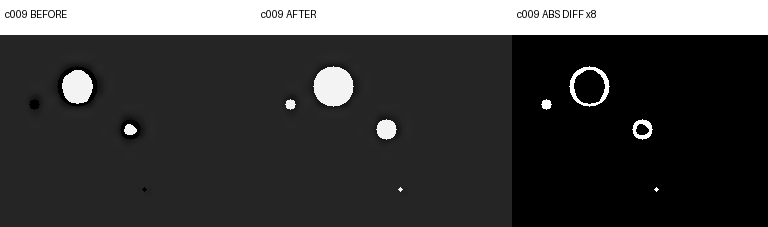
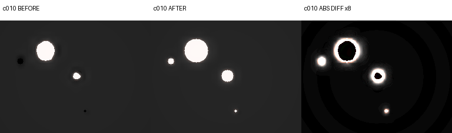
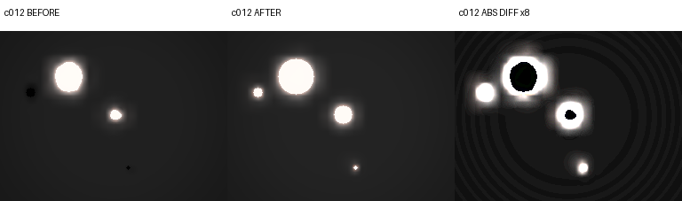
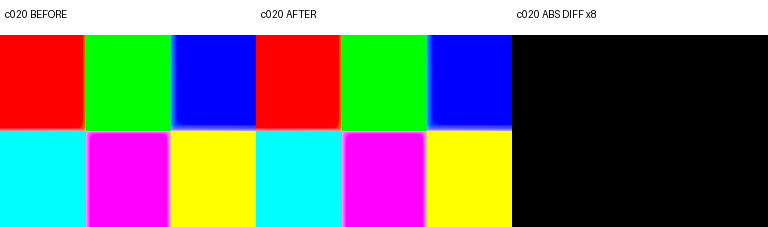
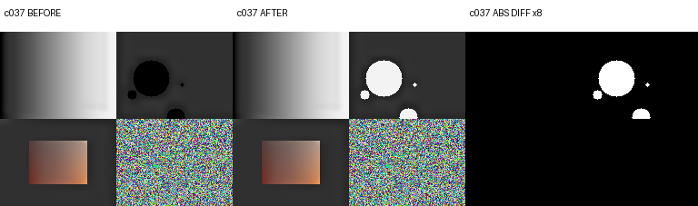
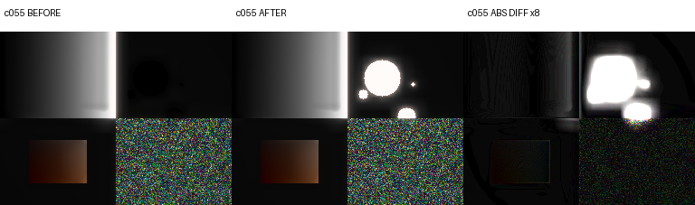
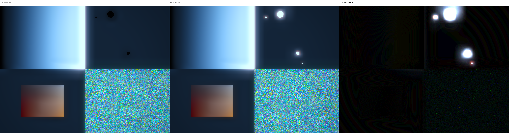

# #355 R7 foundation 修正候補の90条件比較（未採用）

PR #361 の本人目視用資料です。**採用基準ではありません。** 旧基準のgzip・capture・approvalは変更していません。
候補sourceは `51b691ad561da05dde1c8f9a2e9cde09b2656860`、同じseed・90条件・AVD/driver環境です。
製品APK SHA-256: `7d6246e70cc0ca18494ee0a3628e8e716c18b91b7c2c1fa874fdad805bb04fbd`。

## 観測結果と留保

- 90条件＋保存帯64/256行の28比較は完了、帯/fullは全て厳密RGB8一致。1試験成功・skip0。これを90個のJUnit試験とは数えません。
- **修正前後で変化したのは既知黒化の13条件、残77条件はRGB8完全一致。c020も完全一致**で、既存の色境界にじみを今回修正した意味ではありません。
- 既存HDR円の領域に限ったnear-black（全RGB≤3）は、13条件すべて0へ減りました。この観測基準を画質の合格閾値にはしません。
- 変化は黒点だけに限定されません。明部の修正が後段Glow/Mist等へ伝わり、強さありの条件では広い範囲で差が出ます。c009は1.520%、c010は68.587%、c012は99.042%、c075は76.771%の画素が変化します。小さな1階調の変化も含む割合です。
- 数値は**旧GPU→新GPU**の差です。CPU/GPU比較の参考値とは別です。標準比較器は環境差なし・13画像差を検出し、厳密一致条件ではHOLDのままです。本人確認前に閾値や基準を更新しません。
- 旧完成JPEGは変わりません。修正版の今後の計算へ適用する候補であり、実機・実写の品質や性能は未確認です。

## 代表画像

左=修正前、中央=修正後、右=各RGBチャンネルの絶対差×8（255で飽和）。各パネルは同じ原寸・同じ倍率です。差分の黒は差0、白は各チャンネルの差がおおむね32以上です。GitHubの縮小表示ではなく画像を開いて確認できます。

### c009

### c010

### c012

### c020

### c037

### c055

### c075

## 全90条件

前・後は無変換RGBからのPNGです。各リンクは同じ寸法で、前は既存候補原本の閲覧用PNGを参照し重複コピーしていません。
最大差・P99.9は8bitチャンネルの0〜255単位。変更画素率は1チャンネルでも違う画素の割合です。
完全な数値は [CSV](all90-before-after.csv)、候補の識別情報とPNG hashは [review.json](review.json) を参照してください。

| 条件 | 種類 | 寸法 | 強さ / 色温度 / EV | 前 | 後 | 最大差 | P99.9 | 変更画素% |
|---|---|---|---|---|---|---:|---:|---:|
| c001 | GREY | 256×192 | 0 / 0 / 0 | [前](../../gpu-golden-candidates/golden-20261112-072140-1a6ded41/candidates/c001.png) | [後](candidates/c001.png) | 0 | 0.000 | 0.00000 |
| c002 | GREY | 256×192 | 0.25 / 0 / 0 | [前](../../gpu-golden-candidates/golden-20261112-072140-1a6ded41/candidates/c002.png) | [後](candidates/c002.png) | 0 | 0.000 | 0.00000 |
| c003 | GREY | 256×192 | 0.5 / 0 / 0 | [前](../../gpu-golden-candidates/golden-20261112-072140-1a6ded41/candidates/c003.png) | [後](candidates/c003.png) | 0 | 0.000 | 0.00000 |
| c004 | GREY | 256×192 | 1 / 0 / 0 | [前](../../gpu-golden-candidates/golden-20261112-072140-1a6ded41/candidates/c004.png) | [後](candidates/c004.png) | 0 | 0.000 | 0.00000 |
| c005 | DARK | 256×192 | 0 / 0 / 0 | [前](../../gpu-golden-candidates/golden-20261112-072140-1a6ded41/candidates/c005.png) | [後](candidates/c005.png) | 0 | 0.000 | 0.00000 |
| c006 | DARK | 256×192 | 0.25 / 0 / 0 | [前](../../gpu-golden-candidates/golden-20261112-072140-1a6ded41/candidates/c006.png) | [後](candidates/c006.png) | 0 | 0.000 | 0.00000 |
| c007 | DARK | 256×192 | 0.5 / 0 / 0 | [前](../../gpu-golden-candidates/golden-20261112-072140-1a6ded41/candidates/c007.png) | [後](candidates/c007.png) | 0 | 0.000 | 0.00000 |
| c008 | DARK | 256×192 | 1 / 0 / 0 | [前](../../gpu-golden-candidates/golden-20261112-072140-1a6ded41/candidates/c008.png) | [後](candidates/c008.png) | 0 | 0.000 | 0.00000 |
| c009 | HDR_LIGHTS | 256×192 | 0 / 0 / 0 | [前](../../gpu-golden-candidates/golden-20261112-072140-1a6ded41/candidates/c009.png) | [後](candidates/c009.png) | 243 | 243.000 | 1.51978 |
| c010 | HDR_LIGHTS | 256×192 | 0.25 / 0 / 0 | [前](../../gpu-golden-candidates/golden-20261112-072140-1a6ded41/candidates/c010.png) | [後](candidates/c010.png) | 252 | 245.000 | 68.58724 |
| c011 | HDR_LIGHTS | 256×192 | 0.5 / 0 / 0 | [前](../../gpu-golden-candidates/golden-20261112-072140-1a6ded41/candidates/c011.png) | [後](candidates/c011.png) | 254 | 247.000 | 98.63688 |
| c012 | HDR_LIGHTS | 256×192 | 1 / 0 / 0 | [前](../../gpu-golden-candidates/golden-20261112-072140-1a6ded41/candidates/c012.png) | [後](candidates/c012.png) | 254 | 249.000 | 99.04175 |
| c013 | SKIN | 256×192 | 0 / 0 / 0 | [前](../../gpu-golden-candidates/golden-20261112-072140-1a6ded41/candidates/c013.png) | [後](candidates/c013.png) | 0 | 0.000 | 0.00000 |
| c014 | SKIN | 256×192 | 0.25 / 0 / 0 | [前](../../gpu-golden-candidates/golden-20261112-072140-1a6ded41/candidates/c014.png) | [後](candidates/c014.png) | 0 | 0.000 | 0.00000 |
| c015 | SKIN | 256×192 | 0.5 / 0 / 0 | [前](../../gpu-golden-candidates/golden-20261112-072140-1a6ded41/candidates/c015.png) | [後](candidates/c015.png) | 0 | 0.000 | 0.00000 |
| c016 | SKIN | 256×192 | 1 / 0 / 0 | [前](../../gpu-golden-candidates/golden-20261112-072140-1a6ded41/candidates/c016.png) | [後](candidates/c016.png) | 0 | 0.000 | 0.00000 |
| c017 | SATURATED | 256×192 | 0 / 0 / 0 | [前](../../gpu-golden-candidates/golden-20261112-072140-1a6ded41/candidates/c017.png) | [後](candidates/c017.png) | 0 | 0.000 | 0.00000 |
| c018 | SATURATED | 256×192 | 0.25 / 0 / 0 | [前](../../gpu-golden-candidates/golden-20261112-072140-1a6ded41/candidates/c018.png) | [後](candidates/c018.png) | 0 | 0.000 | 0.00000 |
| c019 | SATURATED | 256×192 | 0.5 / 0 / 0 | [前](../../gpu-golden-candidates/golden-20261112-072140-1a6ded41/candidates/c019.png) | [後](candidates/c019.png) | 0 | 0.000 | 0.00000 |
| c020 | SATURATED | 256×192 | 1 / 0 / 0 | [前](../../gpu-golden-candidates/golden-20261112-072140-1a6ded41/candidates/c020.png) | [後](candidates/c020.png) | 0 | 0.000 | 0.00000 |
| c021 | NEAR_WHITE_0 | 256×192 | 0 / 0 / 0 | [前](../../gpu-golden-candidates/golden-20261112-072140-1a6ded41/candidates/c021.png) | [後](candidates/c021.png) | 0 | 0.000 | 0.00000 |
| c022 | NEAR_WHITE_0 | 256×192 | 0.25 / 0 / 0 | [前](../../gpu-golden-candidates/golden-20261112-072140-1a6ded41/candidates/c022.png) | [後](candidates/c022.png) | 0 | 0.000 | 0.00000 |
| c023 | NEAR_WHITE_0 | 256×192 | 0.5 / 0 / 0 | [前](../../gpu-golden-candidates/golden-20261112-072140-1a6ded41/candidates/c023.png) | [後](candidates/c023.png) | 0 | 0.000 | 0.00000 |
| c024 | NEAR_WHITE_0 | 256×192 | 1 / 0 / 0 | [前](../../gpu-golden-candidates/golden-20261112-072140-1a6ded41/candidates/c024.png) | [後](candidates/c024.png) | 0 | 0.000 | 0.00000 |
| c025 | NEAR_WHITE_2 | 256×192 | 0 / 0 / 0 | [前](../../gpu-golden-candidates/golden-20261112-072140-1a6ded41/candidates/c025.png) | [後](candidates/c025.png) | 0 | 0.000 | 0.00000 |
| c026 | NEAR_WHITE_2 | 256×192 | 0.25 / 0 / 0 | [前](../../gpu-golden-candidates/golden-20261112-072140-1a6ded41/candidates/c026.png) | [後](candidates/c026.png) | 0 | 0.000 | 0.00000 |
| c027 | NEAR_WHITE_2 | 256×192 | 0.5 / 0 / 0 | [前](../../gpu-golden-candidates/golden-20261112-072140-1a6ded41/candidates/c027.png) | [後](candidates/c027.png) | 0 | 0.000 | 0.00000 |
| c028 | NEAR_WHITE_2 | 256×192 | 1 / 0 / 0 | [前](../../gpu-golden-candidates/golden-20261112-072140-1a6ded41/candidates/c028.png) | [後](candidates/c028.png) | 0 | 0.000 | 0.00000 |
| c029 | NEAR_WHITE_5 | 256×192 | 0 / 0 / 0 | [前](../../gpu-golden-candidates/golden-20261112-072140-1a6ded41/candidates/c029.png) | [後](candidates/c029.png) | 0 | 0.000 | 0.00000 |
| c030 | NEAR_WHITE_5 | 256×192 | 0.25 / 0 / 0 | [前](../../gpu-golden-candidates/golden-20261112-072140-1a6ded41/candidates/c030.png) | [後](candidates/c030.png) | 0 | 0.000 | 0.00000 |
| c031 | NEAR_WHITE_5 | 256×192 | 0.5 / 0 / 0 | [前](../../gpu-golden-candidates/golden-20261112-072140-1a6ded41/candidates/c031.png) | [後](candidates/c031.png) | 0 | 0.000 | 0.00000 |
| c032 | NEAR_WHITE_5 | 256×192 | 1 / 0 / 0 | [前](../../gpu-golden-candidates/golden-20261112-072140-1a6ded41/candidates/c032.png) | [後](candidates/c032.png) | 0 | 0.000 | 0.00000 |
| c033 | NOISE | 256×192 | 0 / 0 / 0 | [前](../../gpu-golden-candidates/golden-20261112-072140-1a6ded41/candidates/c033.png) | [後](candidates/c033.png) | 0 | 0.000 | 0.00000 |
| c034 | NOISE | 256×192 | 0.25 / 0 / 0 | [前](../../gpu-golden-candidates/golden-20261112-072140-1a6ded41/candidates/c034.png) | [後](candidates/c034.png) | 0 | 0.000 | 0.00000 |
| c035 | NOISE | 256×192 | 0.5 / 0 / 0 | [前](../../gpu-golden-candidates/golden-20261112-072140-1a6ded41/candidates/c035.png) | [後](candidates/c035.png) | 0 | 0.000 | 0.00000 |
| c036 | NOISE | 256×192 | 1 / 0 / 0 | [前](../../gpu-golden-candidates/golden-20261112-072140-1a6ded41/candidates/c036.png) | [後](candidates/c036.png) | 0 | 0.000 | 0.00000 |
| c037 | MIXED | 256×192 | 0 / 0 / 0 | [前](../../gpu-golden-candidates/golden-20261112-072140-1a6ded41/candidates/c037.png) | [後](candidates/c037.png) | 243 | 243.000 | 3.13110 |
| c038 | MIXED | 256×192 | 0.25 / 0 / 0 | [前](../../gpu-golden-candidates/golden-20261112-072140-1a6ded41/candidates/c038.png) | [後](candidates/c038.png) | 254 | 254.000 | 65.80200 |
| c039 | MIXED | 256×192 | 0.5 / 0 / 0 | [前](../../gpu-golden-candidates/golden-20261112-072140-1a6ded41/candidates/c039.png) | [後](candidates/c039.png) | 255 | 255.000 | 69.66349 |
| c040 | MIXED | 256×192 | 1 / 0 / 0 | [前](../../gpu-golden-candidates/golden-20261112-072140-1a6ded41/candidates/c040.png) | [後](candidates/c040.png) | 255 | 255.000 | 47.57487 |
| c041 | DARK | 256×192 | 0.5 / -100 / 0 | [前](../../gpu-golden-candidates/golden-20261112-072140-1a6ded41/candidates/c041.png) | [後](candidates/c041.png) | 0 | 0.000 | 0.00000 |
| c042 | DARK | 256×192 | 0.5 / 100 / 0 | [前](../../gpu-golden-candidates/golden-20261112-072140-1a6ded41/candidates/c042.png) | [後](candidates/c042.png) | 0 | 0.000 | 0.00000 |
| c043 | DARK | 256×192 | 0.5 / 0 / -2 | [前](../../gpu-golden-candidates/golden-20261112-072140-1a6ded41/candidates/c043.png) | [後](candidates/c043.png) | 0 | 0.000 | 0.00000 |
| c044 | DARK | 256×192 | 0.5 / 0 / 2 | [前](../../gpu-golden-candidates/golden-20261112-072140-1a6ded41/candidates/c044.png) | [後](candidates/c044.png) | 0 | 0.000 | 0.00000 |
| c045 | DARK | 256×192 | 0.5 / -100 / -2 | [前](../../gpu-golden-candidates/golden-20261112-072140-1a6ded41/candidates/c045.png) | [後](candidates/c045.png) | 0 | 0.000 | 0.00000 |
| c046 | DARK | 256×192 | 0.5 / 100 / 2 | [前](../../gpu-golden-candidates/golden-20261112-072140-1a6ded41/candidates/c046.png) | [後](candidates/c046.png) | 0 | 0.000 | 0.00000 |
| c047 | SKIN | 256×192 | 0.5 / -100 / 0 | [前](../../gpu-golden-candidates/golden-20261112-072140-1a6ded41/candidates/c047.png) | [後](candidates/c047.png) | 0 | 0.000 | 0.00000 |
| c048 | SKIN | 256×192 | 0.5 / 100 / 0 | [前](../../gpu-golden-candidates/golden-20261112-072140-1a6ded41/candidates/c048.png) | [後](candidates/c048.png) | 0 | 0.000 | 0.00000 |
| c049 | SKIN | 256×192 | 0.5 / 0 / -2 | [前](../../gpu-golden-candidates/golden-20261112-072140-1a6ded41/candidates/c049.png) | [後](candidates/c049.png) | 0 | 0.000 | 0.00000 |
| c050 | SKIN | 256×192 | 0.5 / 0 / 2 | [前](../../gpu-golden-candidates/golden-20261112-072140-1a6ded41/candidates/c050.png) | [後](candidates/c050.png) | 0 | 0.000 | 0.00000 |
| c051 | SKIN | 256×192 | 0.5 / -100 / -2 | [前](../../gpu-golden-candidates/golden-20261112-072140-1a6ded41/candidates/c051.png) | [後](candidates/c051.png) | 0 | 0.000 | 0.00000 |
| c052 | SKIN | 256×192 | 0.5 / 100 / 2 | [前](../../gpu-golden-candidates/golden-20261112-072140-1a6ded41/candidates/c052.png) | [後](candidates/c052.png) | 0 | 0.000 | 0.00000 |
| c053 | MIXED | 256×192 | 0.5 / -100 / 0 | [前](../../gpu-golden-candidates/golden-20261112-072140-1a6ded41/candidates/c053.png) | [後](candidates/c053.png) | 255 | 255.000 | 83.79110 |
| c054 | MIXED | 256×192 | 0.5 / 100 / 0 | [前](../../gpu-golden-candidates/golden-20261112-072140-1a6ded41/candidates/c054.png) | [後](candidates/c054.png) | 255 | 255.000 | 86.99951 |
| c055 | MIXED | 256×192 | 0.5 / 0 / -2 | [前](../../gpu-golden-candidates/golden-20261112-072140-1a6ded41/candidates/c055.png) | [後](candidates/c055.png) | 255 | 255.000 | 91.47135 |
| c056 | MIXED | 256×192 | 0.5 / 0 / 2 | [前](../../gpu-golden-candidates/golden-20261112-072140-1a6ded41/candidates/c056.png) | [後](candidates/c056.png) | 0 | 0.000 | 0.00000 |
| c057 | MIXED | 256×192 | 0.5 / -100 / -2 | [前](../../gpu-golden-candidates/golden-20261112-072140-1a6ded41/candidates/c057.png) | [後](candidates/c057.png) | 255 | 255.000 | 98.33171 |
| c058 | MIXED | 256×192 | 0.5 / 100 / 2 | [前](../../gpu-golden-candidates/golden-20261112-072140-1a6ded41/candidates/c058.png) | [後](candidates/c058.png) | 0 | 0.000 | 0.00000 |
| c059 | DARK | 1024×768 | 0.5 / 0 / 0 | [前](../../gpu-golden-candidates/golden-20261112-072140-1a6ded41/candidates/c059.png) | [後](candidates/c059.png) | 0 | 0.000 | 0.00000 |
| c060 | DARK | 768×1024 | 0.5 / 0 / 0 | [前](../../gpu-golden-candidates/golden-20261112-072140-1a6ded41/candidates/c060.png) | [後](candidates/c060.png) | 0 | 0.000 | 0.00000 |
| c061 | DARK | 1024×576 | 0.5 / 0 / 0 | [前](../../gpu-golden-candidates/golden-20261112-072140-1a6ded41/candidates/c061.png) | [後](candidates/c061.png) | 0 | 0.000 | 0.00000 |
| c062 | DARK | 886×887 | 0.5 / 0 / 0 | [前](../../gpu-golden-candidates/golden-20261112-072140-1a6ded41/candidates/c062.png) | [後](candidates/c062.png) | 0 | 0.000 | 0.00000 |
| c063 | DARK | 1024×768 | 1 / -100 / -2 | [前](../../gpu-golden-candidates/golden-20261112-072140-1a6ded41/candidates/c063.png) | [後](candidates/c063.png) | 0 | 0.000 | 0.00000 |
| c064 | DARK | 1024×768 | 1 / 100 / 2 | [前](../../gpu-golden-candidates/golden-20261112-072140-1a6ded41/candidates/c064.png) | [後](candidates/c064.png) | 0 | 0.000 | 0.00000 |
| c065 | SKIN | 1024×768 | 0.5 / 0 / 0 | [前](../../gpu-golden-candidates/golden-20261112-072140-1a6ded41/candidates/c065.png) | [後](candidates/c065.png) | 0 | 0.000 | 0.00000 |
| c066 | SKIN | 768×1024 | 0.5 / 0 / 0 | [前](../../gpu-golden-candidates/golden-20261112-072140-1a6ded41/candidates/c066.png) | [後](candidates/c066.png) | 0 | 0.000 | 0.00000 |
| c067 | SKIN | 1024×576 | 0.5 / 0 / 0 | [前](../../gpu-golden-candidates/golden-20261112-072140-1a6ded41/candidates/c067.png) | [後](candidates/c067.png) | 0 | 0.000 | 0.00000 |
| c068 | SKIN | 886×887 | 0.5 / 0 / 0 | [前](../../gpu-golden-candidates/golden-20261112-072140-1a6ded41/candidates/c068.png) | [後](candidates/c068.png) | 0 | 0.000 | 0.00000 |
| c069 | SKIN | 1024×768 | 1 / -100 / -2 | [前](../../gpu-golden-candidates/golden-20261112-072140-1a6ded41/candidates/c069.png) | [後](candidates/c069.png) | 0 | 0.000 | 0.00000 |
| c070 | SKIN | 1024×768 | 1 / 100 / 2 | [前](../../gpu-golden-candidates/golden-20261112-072140-1a6ded41/candidates/c070.png) | [後](candidates/c070.png) | 0 | 0.000 | 0.00000 |
| c071 | MIXED | 1024×768 | 0.5 / 0 / 0 | [前](../../gpu-golden-candidates/golden-20261112-072140-1a6ded41/candidates/c071.png) | [後](candidates/c071.png) | 0 | 0.000 | 0.00000 |
| c072 | MIXED | 768×1024 | 0.5 / 0 / 0 | [前](../../gpu-golden-candidates/golden-20261112-072140-1a6ded41/candidates/c072.png) | [後](candidates/c072.png) | 0 | 0.000 | 0.00000 |
| c073 | MIXED | 1024×576 | 0.5 / 0 / 0 | [前](../../gpu-golden-candidates/golden-20261112-072140-1a6ded41/candidates/c073.png) | [後](candidates/c073.png) | 0 | 0.000 | 0.00000 |
| c074 | MIXED | 886×887 | 0.5 / 0 / 0 | [前](../../gpu-golden-candidates/golden-20261112-072140-1a6ded41/candidates/c074.png) | [後](candidates/c074.png) | 0 | 0.000 | 0.00000 |
| c075 | MIXED | 1024×768 | 1 / -100 / -2 | [前](../../gpu-golden-candidates/golden-20261112-072140-1a6ded41/candidates/c075.png) | [後](candidates/c075.png) | 255 | 252.000 | 76.77129 |
| c076 | MIXED | 1024×768 | 1 / 100 / 2 | [前](../../gpu-golden-candidates/golden-20261112-072140-1a6ded41/candidates/c076.png) | [後](candidates/c076.png) | 0 | 0.000 | 0.00000 |
| c077 | GREY | 1600×1200 | 0 / 0 / 0 | [前](../../gpu-golden-candidates/golden-20261112-072140-1a6ded41/candidates/c077.png) | [後](candidates/c077.png) | 0 | 0.000 | 0.00000 |
| c078 | DARK | 1600×1200 | 0.25 / 0 / 0 | [前](../../gpu-golden-candidates/golden-20261112-072140-1a6ded41/candidates/c078.png) | [後](candidates/c078.png) | 0 | 0.000 | 0.00000 |
| c079 | HDR_LIGHTS | 1600×1200 | 0.5 / 0 / 0 | [前](../../gpu-golden-candidates/golden-20261112-072140-1a6ded41/candidates/c079.png) | [後](candidates/c079.png) | 0 | 0.000 | 0.00000 |
| c080 | SKIN | 1600×1200 | 1 / -100 / -2 | [前](../../gpu-golden-candidates/golden-20261112-072140-1a6ded41/candidates/c080.png) | [後](candidates/c080.png) | 0 | 0.000 | 0.00000 |
| c081 | SATURATED | 1600×1200 | 0 / 0 / 0 | [前](../../gpu-golden-candidates/golden-20261112-072140-1a6ded41/candidates/c081.png) | [後](candidates/c081.png) | 0 | 0.000 | 0.00000 |
| c082 | NEAR_WHITE_2 | 1600×1200 | 0.25 / 0 / 0 | [前](../../gpu-golden-candidates/golden-20261112-072140-1a6ded41/candidates/c082.png) | [後](candidates/c082.png) | 0 | 0.000 | 0.00000 |
| c083 | MIXED | 1600×1200 | 0.5 / 100 / 2 | [前](../../gpu-golden-candidates/golden-20261112-072140-1a6ded41/candidates/c083.png) | [後](candidates/c083.png) | 0 | 0.000 | 0.00000 |
| c084 | GREY | 1597×1199 | 0 / 0 / 0 | [前](../../gpu-golden-candidates/golden-20261112-072140-1a6ded41/candidates/c084.png) | [後](candidates/c084.png) | 0 | 0.000 | 0.00000 |
| c085 | DARK | 1597×1199 | 0.25 / 0 / 0 | [前](../../gpu-golden-candidates/golden-20261112-072140-1a6ded41/candidates/c085.png) | [後](candidates/c085.png) | 0 | 0.000 | 0.00000 |
| c086 | HDR_LIGHTS | 1597×1199 | 0.5 / 0 / 0 | [前](../../gpu-golden-candidates/golden-20261112-072140-1a6ded41/candidates/c086.png) | [後](candidates/c086.png) | 0 | 0.000 | 0.00000 |
| c087 | SKIN | 1597×1199 | 1 / -100 / -2 | [前](../../gpu-golden-candidates/golden-20261112-072140-1a6ded41/candidates/c087.png) | [後](candidates/c087.png) | 0 | 0.000 | 0.00000 |
| c088 | SATURATED | 1597×1199 | 0 / 0 / 0 | [前](../../gpu-golden-candidates/golden-20261112-072140-1a6ded41/candidates/c088.png) | [後](candidates/c088.png) | 0 | 0.000 | 0.00000 |
| c089 | NEAR_WHITE_2 | 1597×1199 | 0.25 / 0 / 0 | [前](../../gpu-golden-candidates/golden-20261112-072140-1a6ded41/candidates/c089.png) | [後](candidates/c089.png) | 0 | 0.000 | 0.00000 |
| c090 | MIXED | 1597×1199 | 0.5 / 100 / 2 | [前](../../gpu-golden-candidates/golden-20261112-072140-1a6ded41/candidates/c090.png) | [後](candidates/c090.png) | 0 | 0.000 | 0.00000 |
