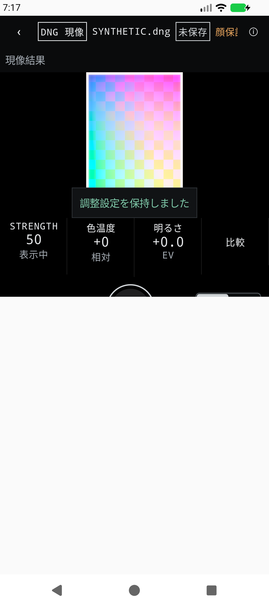
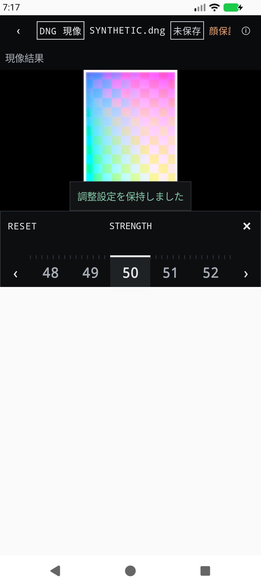
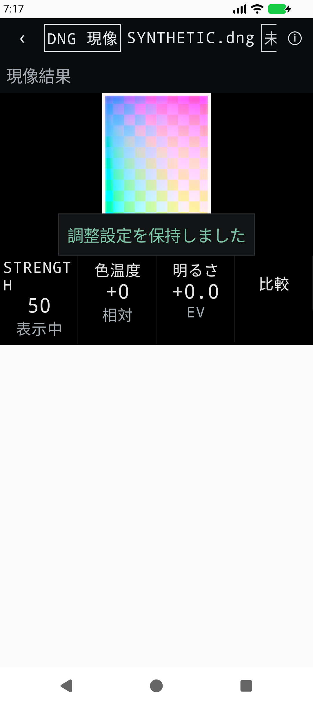
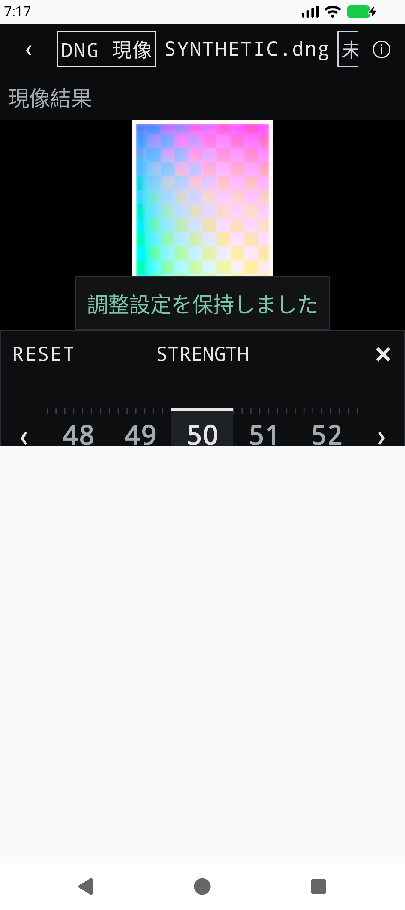

# 案A：短い画面の通知を短文に変更

Issue #452 / Draft PR #454。案A（全画面で画像下端に重ね、予約領域を持たない）は本人方針に採用済み。**以下の短文の見た目は本人確認待ち。未マージです。**

短い画面だけ、現行の成功TOASTを「調整設定を保持しました」「JPEGを保存しました」に変更しました。通常画面の文言・約4秒の寿命・優先順位・失敗通知・原本や保存処理は変えていません。どちらの通知も1.3倍／1.8倍で1行でした。省略記号や行数制限で文を隠していません。

以下は変更後の4画面のみです。同じ合成RGB格子、短500dp fixture、専用AOSP AVDで実際に撮影。実写真・Pixelは使っていません。

## 文字1.3倍

| パネル閉 | パネル開 |
|---|---|
|  |  |

## 文字1.8倍

| パネル閉 | パネル開 |
|---|---|
|  |  |

## 通知が覆う高さの実測

画像枠は全条件で683px（260dp、キャプション込み）のまま。分母はキャプションを除いた画像領域です。**高さの割合であり、画面全体の面積比や任意の写真の主要被写体の重要度ではありません。**

| 条件 | 通知の幅×高さ | 画像領域高 | 高さの割合 | 行数 |
|---|---:|---:|---:|---:|
| 1.3倍・閉 | 504×122px | 583px | 20.9% | 1 |
| 1.3倍・開 | 504×122px | 583px | 20.9% | 1 |
| 1.8倍・閉 | 680×145px | 560px | 25.9% | 1 |
| 1.8倍・開 | 680×145px | 560px | 25.9% | 1 |

通知は下端中央です。下端の被写体を隠す可能性は残ります。短画面の画像そのものを拡大した変更ではありません。

## 条件と検証範囲

- 実装・試験head `1558c400e3a6818de7ef98983a4abea43dfaad00`。画像/doc追加で製品コードは変えません。
- 1080×2424px、density 2.625、外枠500dpにsafeDrawingPadding。白い下半分はfixture外です。下側の操作は既存のスクロール領域内にあり、全操作が同時に収まるという証拠ではありません。
- compactは利用可能高が`560dp × fontScale`未満、または幅が`360dp × fontScale`未満。今回の1.3倍／1.8倍はいずれもcompactです。1.8倍を2倍とは扱いません。
- lint・単体試験・アプリ/試験APKの4task成功。単体1415件、failure/error0、skip12。lint error0/warning130。
- 合成UI11件成功（既存9＋JPEG成功の短画面2）。通知有無で実layout/native Surface不変、通知が覆わない領域の全pixel一致、アクセシビリティ比較、通知上のtap/長押し/離した後の復帰を確認。既存のassertは緩めていません。
- 追加の既存回帰18件も成功（viewport8、PR-D配置1、message2、保存進捗1、初回画像切替1、保存サービス5）。合計29件成功。初回画像切替は1回目が試験安全引数不足で開始前に拒否されたため、必要なgpuInputSafety引数を明示して再実行し成功。試験のassertは変更していません。
- 約4秒は既存の寿命コードを維持。撮影fixtureは通知を保持するため、このPNGは4秒の実測証拠ではありません。
- 元PNGのまま公開し、text/EXIF chunkなし。個人写真・URI・端末識別子・未加工ログ・個人パスは含めていません。
- 新headのCI/canonical review、本人の短文見た目承認は別ゲートです。
