# 短い画面：現状・案A・案Bの実画面比較

Issue #452 / Draft PR #454。**採否確認用。未採用・未マージ。**
同じ合成RGB格子を同じ専用AOSP AVDで、3候補を別々にビルド・インストールして撮影しました。画像を貼り替えた画面モックではありません。実写真・Pixel・原本・JPEG保存は使用していません。

## 見るポイント

| 候補 | 短い画面の通知 | 画像の下部 | 調整パネル |
|---|---|---|---|
| 現状 | 画像の外。通知が消えても同じ高さを予約 | 隠さない | 通知枠の下 |
| 案A（#454の実装） | 画像の下端に重ねる。予約枠なし | 通知中は隠れる | 予約枠がない分、上に移る |
| 案B（比較専用の試作） | 短い画面・文字拡大時は現状の画像外配置。通常画面だけ重ねる | この比較条件では隠さない | この比較条件では現状と同じ |

**短画面ではどの候補も画像枠は260dp（キャプション込み）のままです。案Aで増えるのは下側の操作に使える高さで、画像自体の高さではありません。**
案AはPR-Dの「短い画面では画像上にキャプションとバナー以外を重ねない」の例外です。案Bは短画面でその規則を維持します。任意の写真の主要被写体が下端にある場合、案Aは隠し得ます。

通知の製品上の表示時間は従来どおり約4秒。この撮影では比較のため通知を保持しています。PNGは消えるまでの時間を検証する証拠ではありません。

## 比較条件と「短い画面」

- 1080×2424px、density 2.625の同一AVD。fixtureの外枠を500dpにし、その内側にsafeDrawingPaddingを適用。白い下半分はfixtureの外です。
- ここで「通常文字」と呼ぶ条件も、この既存fixtureでは**1.3倍**です。拡大条件は**1.8倍**です。2倍の証拠ではありません。
- 製品のcompact判定は、利用可能な高さが`560dp × fontScale`未満、または幅が`360dp × fontScale`未満。物理画面サイズそのものではなく、親から渡された描画可能範囲で判断します。今回の両条件はいずれもcompactです。
- 上部の時計は別撮影のため異なります。通知有無・パネル開閉・画像・寸法・倍率は揃えました。
- 画面下で操作が切れるのは既存の短画面スクロール配置です。全操作が同時に収まる証拠ではありません。

## 文字1.3倍・パネル閉・通知あり

| 現状 | 案A | 案B |
|---|---|---|
|  | 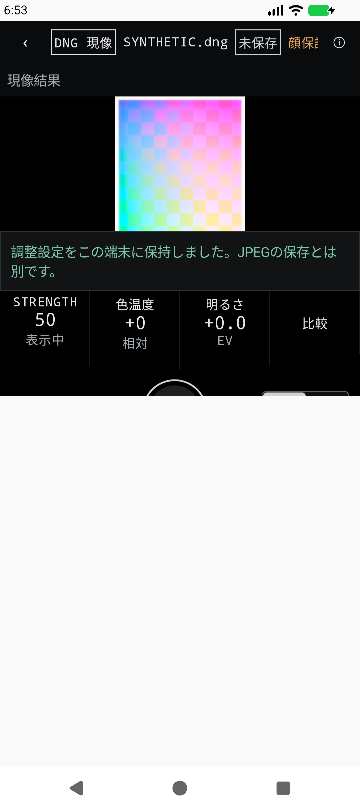 | 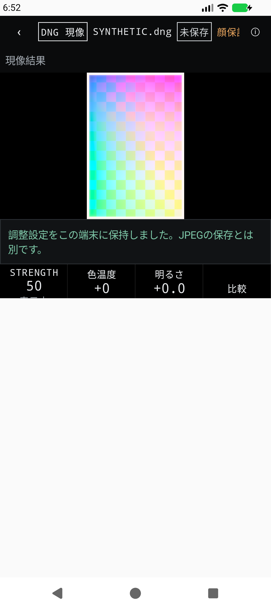 |

## 文字1.3倍・パネル開・通知あり

| 現状 | 案A | 案B |
|---|---|---|
|  | 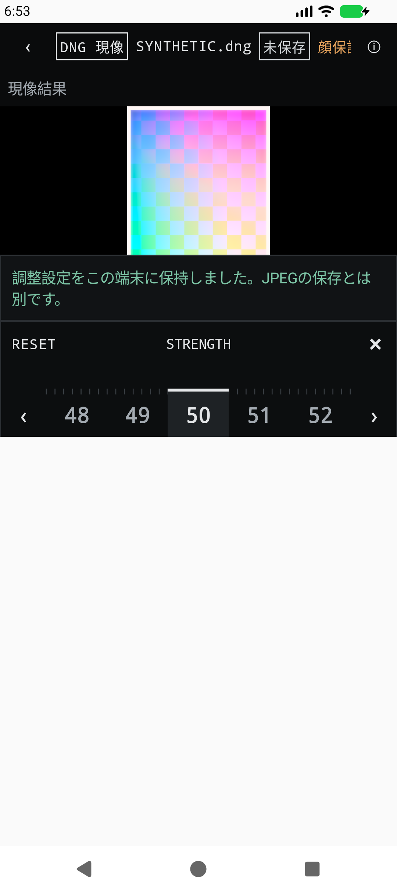 |  |

## 文字1.8倍・パネル閉・通知あり

| 現状 | 案A | 案B |
|---|---|---|
| 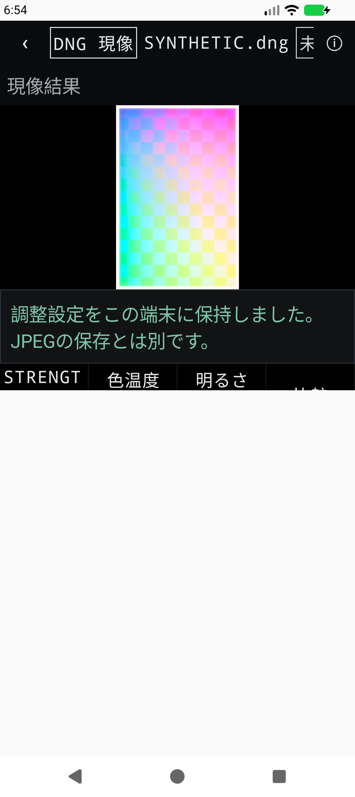 | 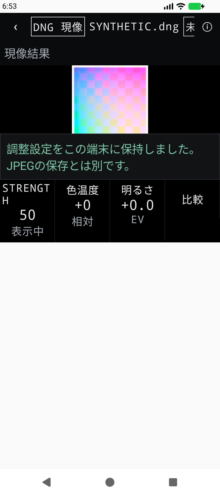 |  |

## 文字1.8倍・パネル開・通知あり

| 現状 | 案A | 案B |
|---|---|---|
| 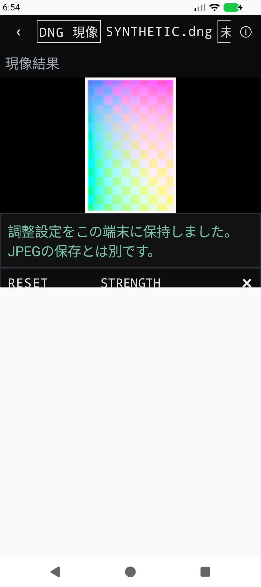 | 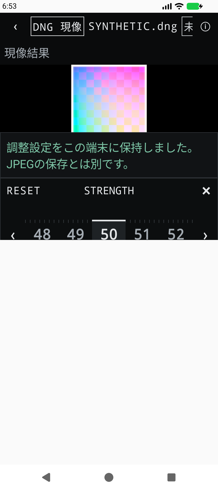 |  |

## 通知なし（予約領域の違い）

| 条件 | 現状 | 案A | 案B |
|---|---|---|---|
| 1.3倍・閉 | 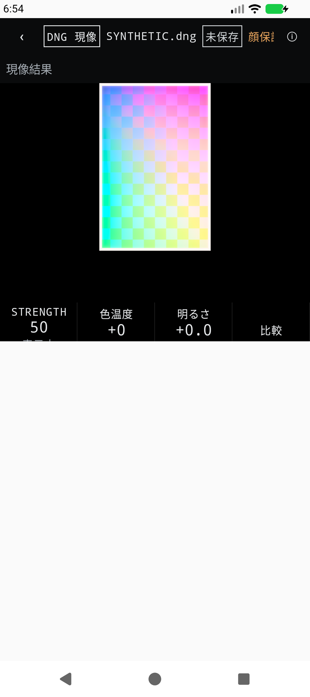 |  |  |
| 1.3倍・開 |  | 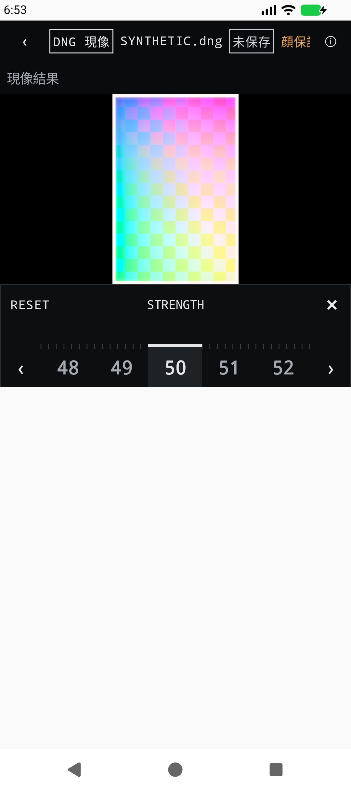 | 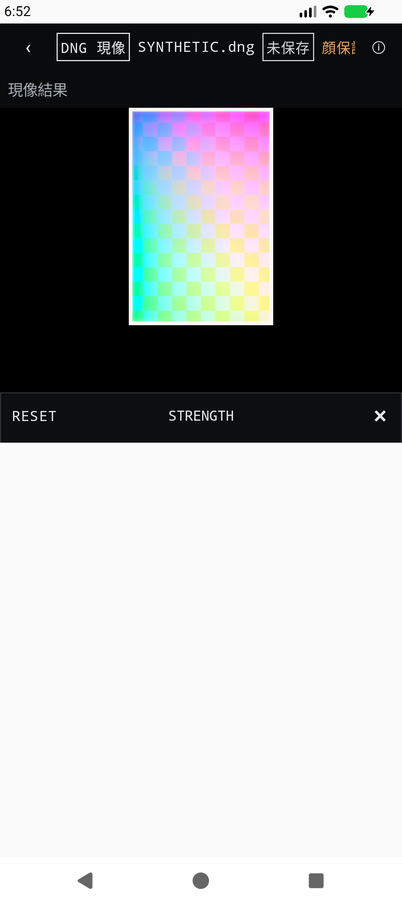 |
| 1.8倍・閉 | 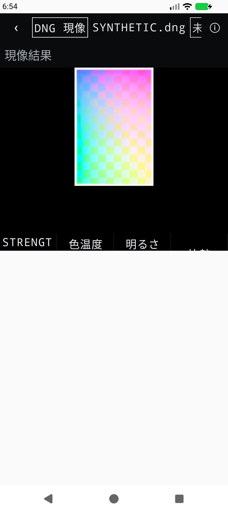 | 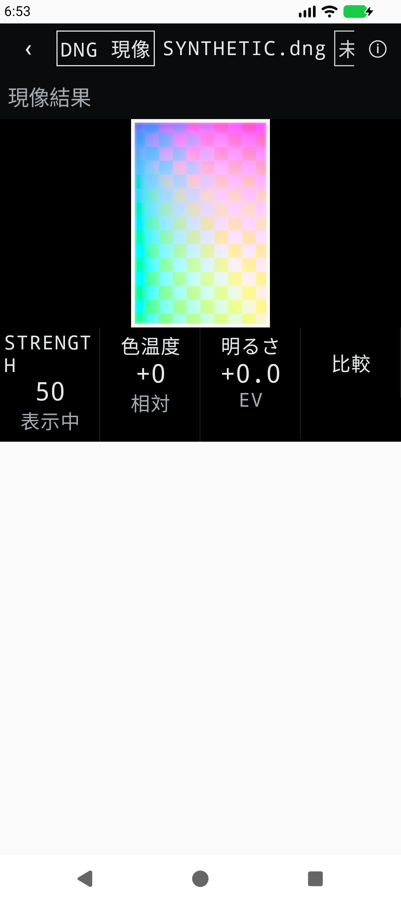 | 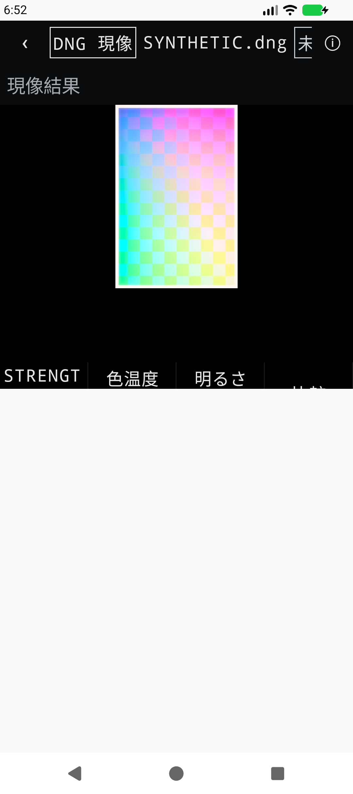 |
| 1.8倍・開 |  | 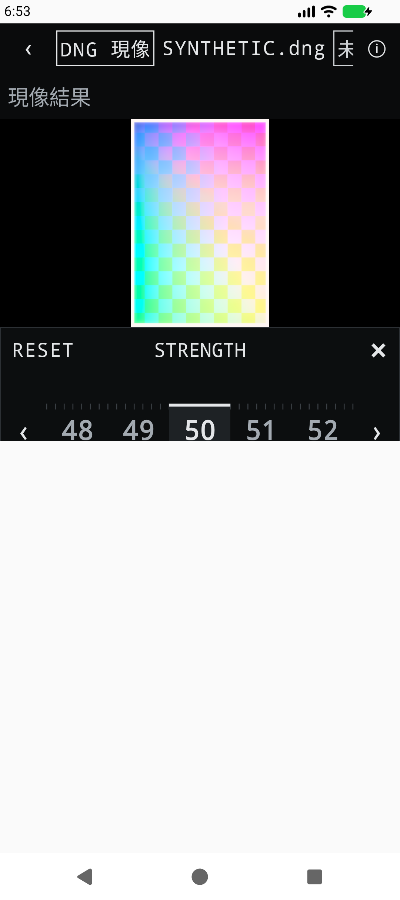 | 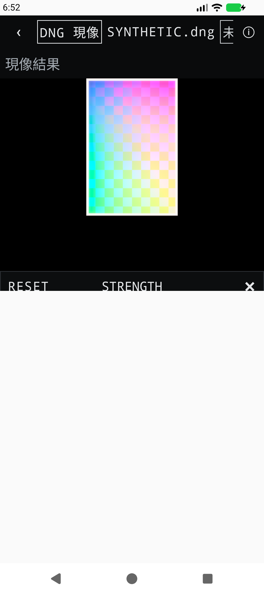 |

## 計測と検証範囲

- 3候補でassembleDebug / assembleDebugAndroidTest成功。共通のartifact専用撮影試験が各1件成功、各8枚、計24枚。これは全回帰合格を意味しません。
- 現状候補のPhotoRollDevelopViewはmain `c3850aa2` と差分0。Aは#454 head `9f0024e9` の表示コード。BはAに対してcompact時だけ従来の外側予約を戻した比較用試作です。比較専用コードを製品PRには含めていません。
- 全候補で画像枠683px（260dp）。キャプションを除く画像領域は文字1.3倍で583px、1.8倍で560px。Aの通知はそれぞれ180px / 226pxを覆い、約31% / 40%の高さを隠します。現状/Bでは通知を画像枠の外に置きます。
- 専用AVDは起動後90秒system_server維持・ANRなしを確認して開始。元のAの厳密な操作/viewport回帰の条件を緩めず、別の撮影専用メソッドで外側配置を比較しました。
- 案Bの製品採用には別途、通常画面を含む回帰とレビューが必要です。本資料は採否のための短画面比較です。
- PNGは撮影出力のまま。実写真・URI・端末固有識別子・未加工ログ・個人パスを公開しません。
