# 現像の一時通知 overlay: 本人採否待ち

Issue #452。以下は**変更案**であり、見た目承認・merge前。実写真/実機を使わない匿名合成画面です。

## PR-D規則との関係と選択肢

既存PR-Dの短画面規則「画像上はキャプションとバナー以外を重ねない」に対して、現候補は**一時TOASTだけの例外を提案**します。仕様の例外追記もまだ提案であり、規則を満たしたことにして採用しません。

- **案A（このbranchの実装）**: すべての画面で通知を画像下端に重ねる。通知がない間の常時予約余白をなくし、通知の有無では画像領域/倍率を変えない。下部の画像は通知で隠れる。
- **案B（推奨、未実装）**: 通常画面だけoverlay、短画面・拡大文字では従来どおり画像外を維持。短画面の旧規則と主要部分の視認を優先する。別実装/別画面検証が必要。この資料に案Bの実装画像は含まない。

任意写真の主要被写体が下端にある場合、案Aはそこを隠し得ます。**「主要部分を隠さない」を保証できません**。短画面では画像260dp固定を維持するため、この変更だけでは画像は大きくなりません。通知は非操作で、通知上のタップ/長押しは画像へ届くことを検証しました。保存失敗などの操作表示・調整パネルは画像外の既存配置を維持します。

### 覆う高さの実測（この合成画面のみ）

| 条件 | パネル閉: 通知高 / 可視画像領域高 | パネル開 |
|---|---|---|
| 通常・文字1倍 | 109 / 1581px（約7%） | 109 / 1263px（約9%） |
| 短500dp・文字1.3倍 | 180 / 583px（約31%） | 同じ |
| 通常高・文字1.8倍 | 226 / 560px（約40%） | 同じ |
| 短500dp・文字1.8倍 | 226 / 560px（約40%） | 同じ |

高さ比であり被写体の重要度や画像面積比ではありません。1.8倍文字は通常高でも既存compact判定となるため、4fixture条件が4種類のレイアウトを意味するわけではありません。

## 表示時間

製品では従来の約4秒（`GpuPhotoRollEditor` の `delay(4000)`）を維持し、通知の優先順位・発生条件・消去処理を変更していません。ここでの合成fixtureは撮影/操作検査用に通知を保持し、手動で解除します。**このPNG/試験は4秒寿命の実測証拠ではありません**。

## 画面

実GPUへ240×360のRGB格子と白枠を投入。1080×2424の専用AOSP emulator screenshot、density 2.625。短画面は高さ500dpのfixtureで、下の白い領域はfixture外です。未スクロール画像では下部操作が切れます。全操作が同時に画面内に収まるという証拠ではなく、短画面の操作到達性は既存スクロール回帰で別確認しています。

### 通常・文字1倍

| 状態 | 通知なし | 通知あり |
|---|---|---|
| パネル閉 | 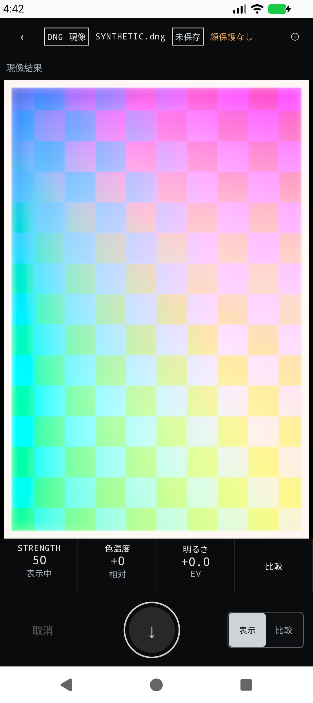 | 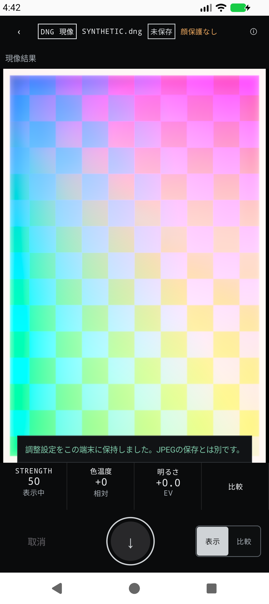 |
| パネル開 | 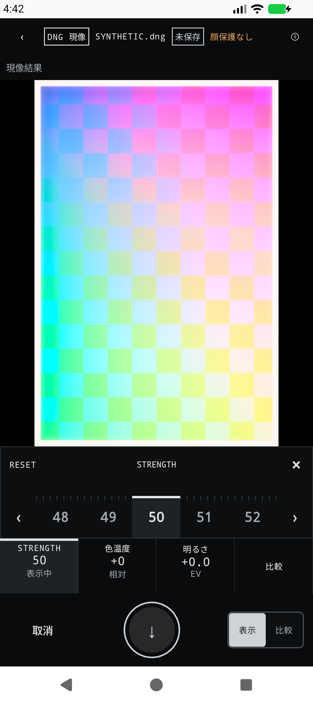 | 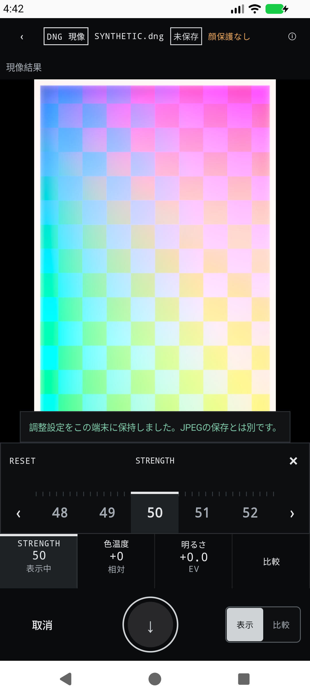 |

### 短500dp・文字1.3倍

| 状態 | 通知なし | 通知あり |
|---|---|---|
| パネル閉 | 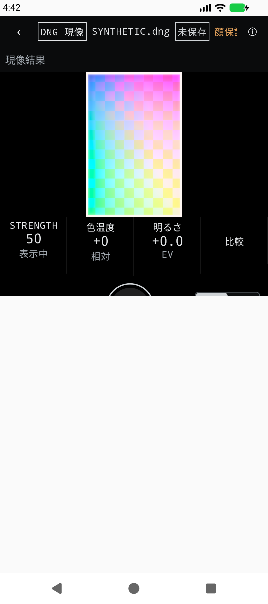 | 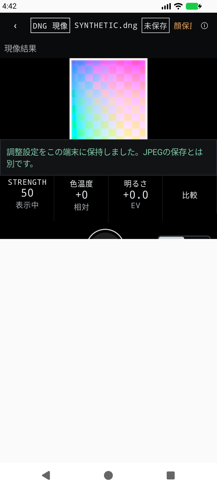 |
| パネル開 | 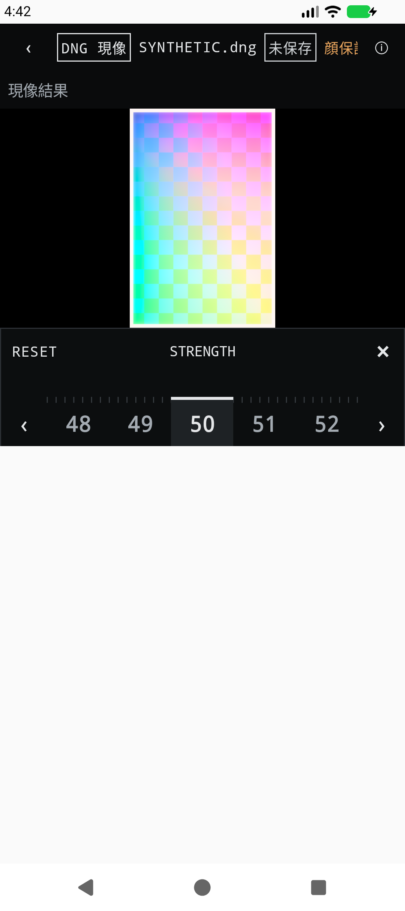 | 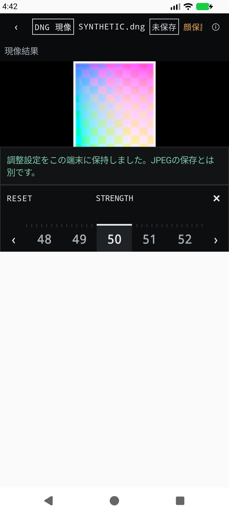 |

### 通常高・文字1.8倍（compact判定）

| 状態 | 通知なし | 通知あり |
|---|---|---|
| パネル閉 | 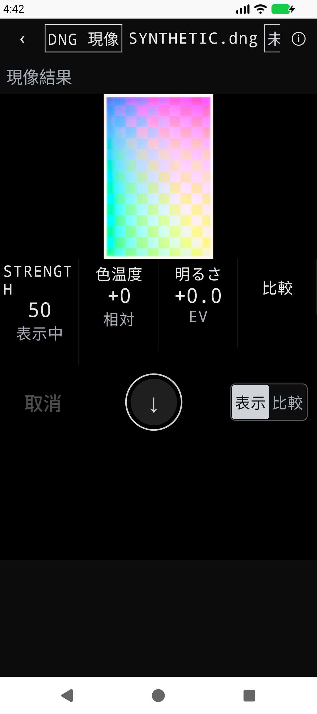 | 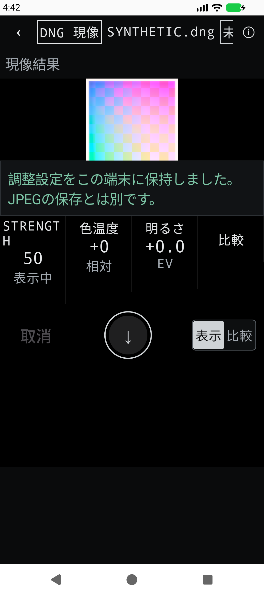 |
| パネル開 | 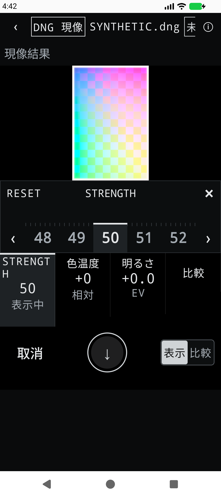 | 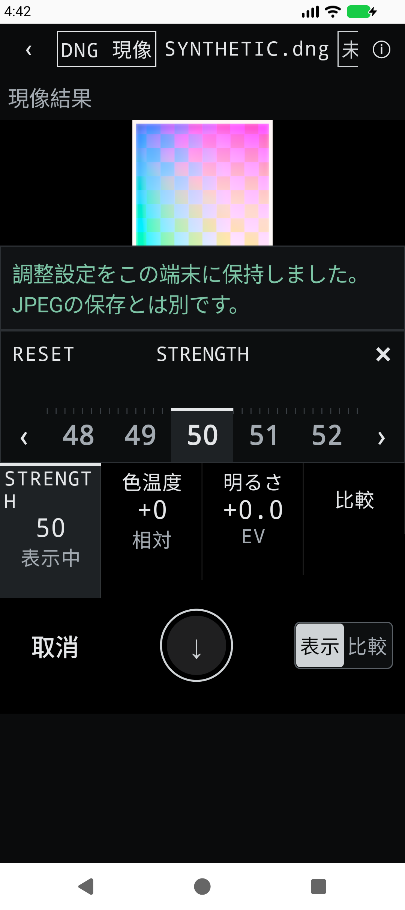 |

### 短500dp・文字1.8倍

| 状態 | 通知なし | 通知あり |
|---|---|---|
| パネル閉 | 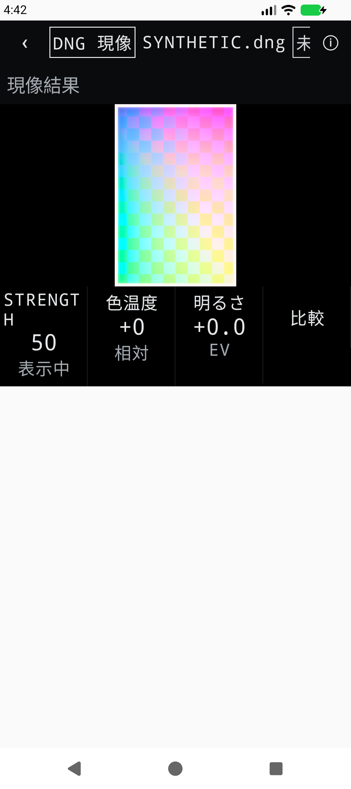 | 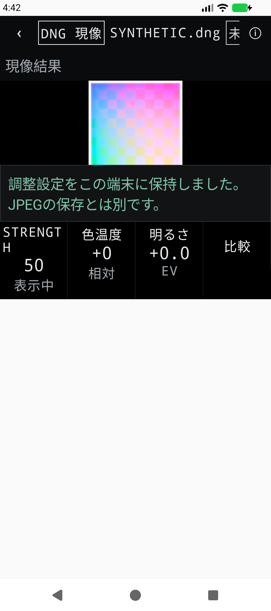 |
| パネル開 | 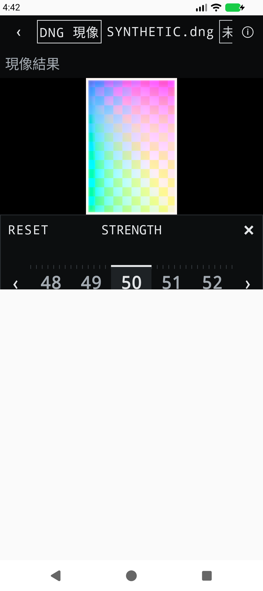 | 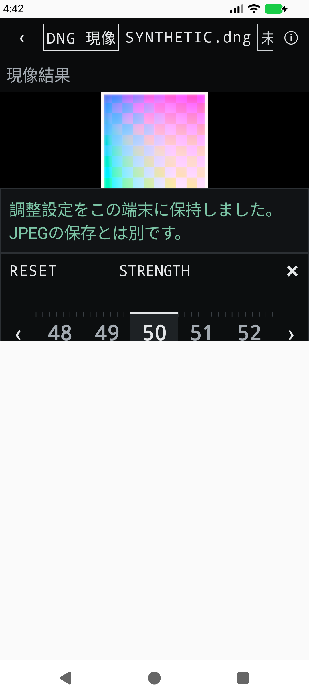 |

## 検証と限界

コード測定head `0dc423dcd58813669d86a312aebf3656f2fc9926`（main `f476442f` 基点）。

- 4task lint/unit/app/testAPK成功。unit 1413件、failure/error0、skip12。lint error0/warning130。
- 新4件＋既存5件のUI回帰9件成功。4条件×パネル開閉で実viewport外枠とnative Surface不変、通知が覆わない画像上側の全pixel一致、通知中のaccessibility比較往復、通知中心へのタップ/長押し/解除を確認。
- 追加既存回帰18件成功（StableViewport8、PR-D配置1、message画面2、保存進捗画面1、初回案内→exact1、保存service5）。実保存/実原本には接続しない合成試験。
- 初回 `6085eb1f` は既存5成功/新4失敗。3件はToastがAccessibilityNode boundsを切り詰める現象、1件は通知消去の非同期待機不足。製品コードを変えず、実layout/画像pixelとsemanticsを区別し、消去はcache再取得付き有界待機に補正。失敗をなかったことにはしない。
- semantics矩形は通知の遮蔽で小さくなる場合があります。実描画領域やタッチ領域の縮小とは区別し、独立のpixel・layout・操作試験を使用。外側viewport計測だけで画像領域を証明していません。
- 顔枠製品機能は未実装。顔枠動作の合格を主張せず、Fit/Surface/タッチ経路を変更していないことと既存試験を区別。
- boot90秒安定、ANR/crash検出なし。終了後Java/QEMU/emulator/専用port残存0。
- 実機での画質/速度/操作感、任意写真の主要被写体の視認は未確認。本人採否前merge禁止。

## PNG完全性

原PNGを加工せず保存。EXIF/text chunkなし。生ログ・URI・個人pathは公開しません。

| ファイル | SHA-256 |
|---|---|
| `toast-compact-default-closed-with.png` | `834f1bc0d442be8bed9c73fa913a6ed6345a7f2120c9d2a42aff41a00b97a2e6` |
| `toast-compact-default-closed-without.png` | `c27acfa9e99822138089701ebf344b3b7e77c482edc467799536a17cca717d00` |
| `toast-compact-default-open-with.png` | `d09b40244e22909f752a4fcd9ef05e8fd46871940521d611e771d3b71e4c5158` |
| `toast-compact-default-open-without.png` | `809202520378eab63020d666f2df3ed1187ee51425ffe566d36190a15f09ceaa` |
| `toast-compact-large-closed-with.png` | `916d7a1973c2d4e33c267204e1296ddefd1f7708a1192899cc464a2e417160e5` |
| `toast-compact-large-closed-without.png` | `f1d99d1910db693652ab24f0b4a4677044678f108009c889b665e9181f930e5f` |
| `toast-compact-large-open-with.png` | `85fe3d5f81d4bfe74009739fe4ab0a513a776097a420846806a8bd5a01a46746` |
| `toast-compact-large-open-without.png` | `ec36521d504b5d5f83200e67f8472ff5e1eb7b82d9b542ae3f3f54d1d6cda9ea` |
| `toast-normal-default-closed-with.png` | `04094ac0a0f4fcf36aef95cd56fdcfdd09e6e3a2e0ddefbbdb025680c683f14a` |
| `toast-normal-default-closed-without.png` | `49aa2702efa3d7d858f40995f26b7a2e90c6871c471f2daa376d63ad43a7d578` |
| `toast-normal-default-open-with.png` | `ec710fc7e354afa5446ed1282ad4b3307bc9e69bd3922bd022c360d5dae7b44c` |
| `toast-normal-default-open-without.png` | `66f5f3f85ec556ce2b668e4dccb7ec52f91a3cf94b03967941ac8515f3b2cc4d` |
| `toast-normal-large-closed-with.png` | `7c62a2c7cce8a2c2c896850aedd65295893115ff25ecc260f7116e453f1e13e0` |
| `toast-normal-large-closed-without.png` | `a15259d173aaecc67e6fd8b51956be1d83b6458a0582c8866006c64abe268964` |
| `toast-normal-large-open-with.png` | `240d71d04ab4d9508a617d43a03d35c2417d25fc2116b535d9c405ab59dd03be` |
| `toast-normal-large-open-without.png` | `f16d71d6d5484f17eee35ccb3830e6f658e67bf663ba3dc553984100e8296de6` |
