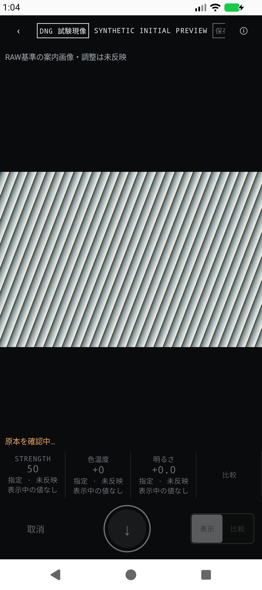
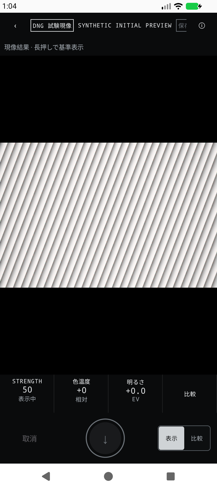

# 初回案内表示: half 比較版の匿名合成画像

## 撮影条件と読み方

- 匿名合成1536×1024入力。実写真・個人の原本ではない。
- portrait AVD のスクリーンショット1080×2424。PNG原bytesを変更せず収録した。
- half比較ONの版で、guideとexactを別時点に取得した。half既定OFFの版の画面証拠ではない。
- 画面を確認するためのhold-runであり、性能計測とは別走行。2枚から待ち時間やちらつきの長さを推定しない。
- 元source `61a678b1` 以降でUI同一の比較用画面。後続sourceの性能・動作検証を代替しない。
- guideはRAW基準の未調整案内像をFit表示する。FULL AHD exactは調整済み現像結果であり、案内像との画素一致は要求しない。
- 実写・実機の画質、速度、色、画角の一致を証明するものではない。採否・マージ承認とは別の比較資料。

## 匿名合成: half案内（未調整）

## 匿名合成: FULL AHD exact（調整済み）

## 原bytesの照合

元PNGと収録PNGのbytesおよびSHA-256一致を確認した。画像編集・再圧縮・縮小なし。

| ファイル | bytes | SHA-256 |
| --- | ---: | --- |
| `guide.png` | 728,069 | `a66ff7882141b2217826d8e0d8df8bd253f0b617b473048687fbeb555dbeb5b1` |
| `exact.png` | 681,861 | `fc003783a8d62650887f6adad0b6d3b37f136b95406d3966e7fc57bed17eaf10` |
