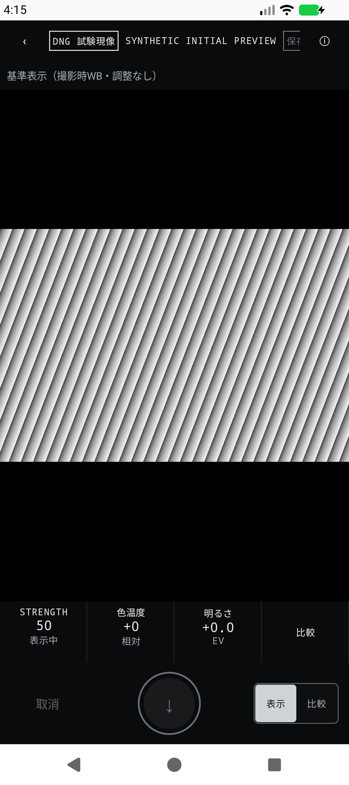

# 初回案内・長押し基準・現像結果の比較

匿名合成 DNG（1536×1024）の同一入力。実写真ではない。撮影 source は `1542c202908f49ae7812b23ff41bc256b70f3756`、AOSP AVD の原PNGは1080×2424。画像の編集・再圧縮なし。

| 仮画像: RAW half案内、調整なし | 実際の長押し: 撮影時WB・調整なし | 本来の表示: FULL AHD、調整あり |
| --- | --- | --- |
|  |  |  |

原寸: [仮画像](guide.png) / [長押し基準](baseline.png) / [本来の表示](exact.png)

## 比較の意味

- 仮画像は埋込JPEGでも保存済JPEGでもなく、同じsnapshotのRAW半解像度から得た案内像。通常製品ではhalf既定OFF。これは明示した合成試験からhalfを呼ぶ撮影用hold-runであり、通常OFF製品でhalfが自動表示される証拠ではない。
- 長押しは実入力イベントでGPUの基準表示へ切替。本来の表示は既存の既定調整値による結果。仮画像と基準に大きな全体の色かぶりは目視で認めず、斜線の縁・階調には差がある。本来の表示はより明るい。実写の色やPixel画質の合格ではない。
- WB設定は変更していない。[共通native decoder](../../../app/src/main/cpp/dng_decoder.cpp) はhalf/FULL双方でlinear sRGB (`output_color=1`)、16bit、撮影時WB（AsShot互換分岐を含む）を使用。[案内変換](../../../app/src/main/java/dev/cinematic/p0/photoroll/TrialDisplayPixels.kt) はclamp+sRGB符号化のみで、追加WB・露出・lookを行わない。デモザイクと縮小は異なるため画素一致は要求しない。
- 同座標の画像矩形 x=[0,1080), y=[706,1426) におけるRGB各channel絶対差の平均（0–255）は、仮画像対基準 **6.4122**、本来対基準 **37.3402**。最大channel差はそれぞれ222、137。混合layout/semantics観測から中央3:2領域を算出したscreen-space指標であり、色差ΔEでもWB一致判定でもない。境界1pxや再サンプル差も含む。

## 画面と保存の確認

- 仮表示中の3値は薄い表示のみ。「指定・未反映」「表示中の値なし」はない。
- captionは仮案内、実長押し基準、現像結果を区別。上下の画像背景は3状態とも黒。
- guide/exact/baselineの混合観測領域は全て `(0,276)-(1080,1857)`。これはlayoutとsemanticsを組み合わせた観測で、描画画素の境界そのものの証明ではない。原PNGも目視確認した。
- 仮表示中の保存actionはdisabled、実tapで保存callbackは0回。View境界の確認であり、Editor/save-owner全体の保存E2Eとは区別する。仮画像を保存入力には使用しない。
- artifact-only撮影1件と比較OFF製品接続E2E4件が成功。撮影用entryはparameter-node検査を行わないため、厳格UI試験全体の合格や速度測定には数えない。以前のclass/node探索失敗と、status overlayによりaccessibility下端が87px clipされた失敗は履歴として保持した。後者は製品UIを変更せず実layout観測を追加した。
- 同じsourceで既存の厳格UI試験も別runで成功（24.77秒）。3値・有効状態・位置/サイズ・viewport・黒背景・長押し復帰のassertを保持したまま通過。上の公開画像はartifact-only runの原PNGであり、厳格試験の画像へ差し替えていない。
- 実機確認、half採否、本人の画面承認、最新headの通常ID回帰/CI/最終レビューは別ゲート。

## 原bytesの照合

PNGにEXIF・text chunkがないことと、取得ファイルとのSHA-256一致を確認。

| ファイル | bytes | SHA-256 |
| --- | ---: | --- |
| `guide.png` | 716,658 | `a3a83b8bd293cc3fb05e41b91f4c03269065615441777b3ae8b4ff3f5902becc` |
| `baseline.png` | 487,764 | `f5db31a6383416511a6d7dc135dff78c49fa3376bbfee375c10eecc24c9f27c4` |
| `exact.png` | 676,357 | `5e9dff3a991fa4fc1db50a226906342fa3cdb4d63f538b7372be88c10965703a` |
