# 保存進捗の画面確認（未承認）

[全30枚の変更前後](index.html)。合成 fixture のみで、実写真・原本・端末識別情報は含まない。

- ソース: `f593f0fb`。アプリ実装は `74774daf` と同一、後続は試験ラベルの修正のみ。
- 4工程と取消中 × 通常・短画面・文字2倍 × 変更前後。
- 変更前は旧バナー文言/操作を現在の共通画面に入力した再現で、旧APKからの撮影ではない。
- Software View capture。GPU描画・実機速度・実保存の操作保証を画像だけから主張しない。
- 短画面は固定360×480dpのfixture。スクリーン全体を短くした実機の代用ではない。
- 保存取消は既存バナー内の1個。下左の無効な「取消」は調整編集用で別操作として維持。
- 画像試験は各ケースで保存取消1個・有効/無効・window内boundsを検査。全体の操作到達性は別の回帰で確認する。
- 文字拡大/短画面の下部操作の切れは変更前後の比較対象。画像承認・マージは未実施。

## ローカル検証の補足

- 画像取得時と後続の `41b82437` は製品ソースtreeが同一。後続変更は既存安全性試験の文言・取消前admission時の状態期待・表示待機を直した試験限定修正。
- GPU出力・境界取消/再試行・journal・observer・readbackの12件、FGSの6件、保存ライフサイクル1件が成功。実機での確認は別。
- FGSの旧試験期待による取消後の未確認表示は、進捗変更前のauthority同一な #443 APK対照でも再現。raw READY・intent/journalなし・JPEG不増・原本照合・資源解放の検査は維持し、保守的な未確認表示と再確認操作を検証した。
- この記録は本人の画面承認を代行しない。公開・マージは未実施。

## GitHub 上での変更前後比較

以下は同じ合成 fixture の変更前・変更後です。本人の見た目確認待ちです。

### 通常

|工程|変更前|変更後|
|---|---|---|
|保存の準備中||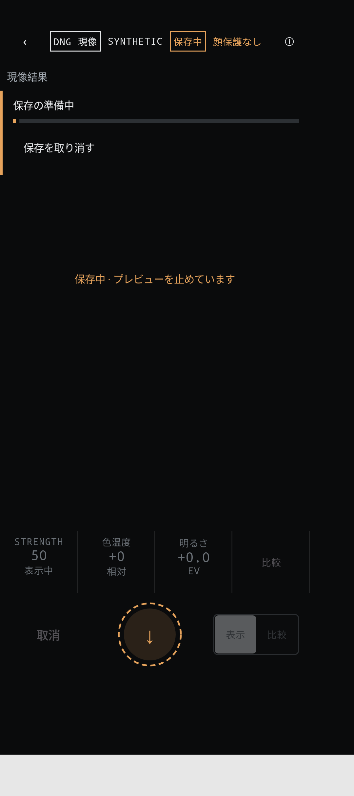|
|画像を現像中||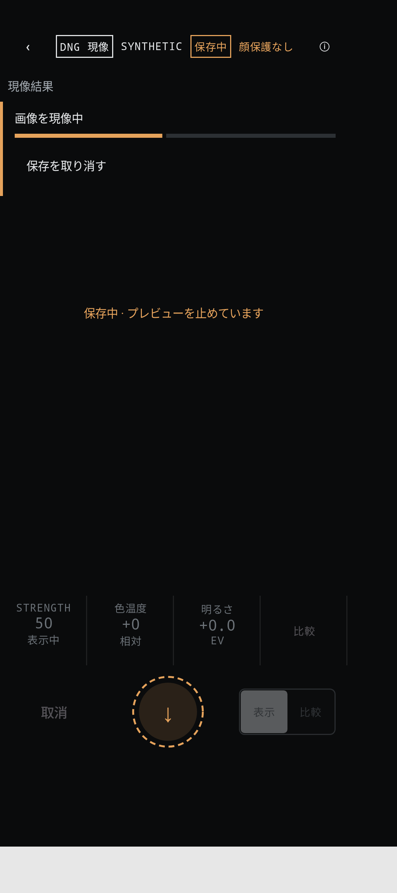|
|JPEGを作成中|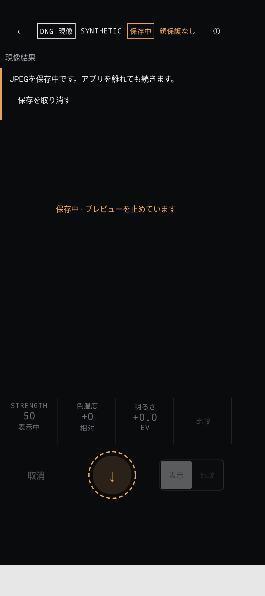|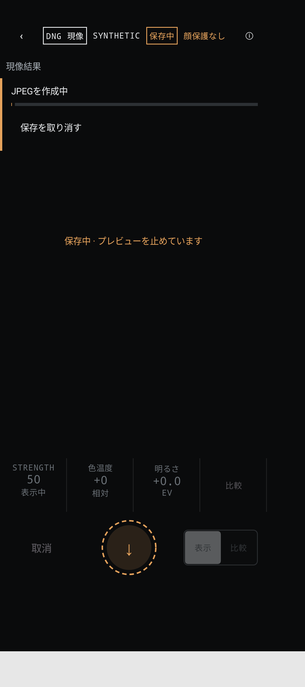|
|保存しています||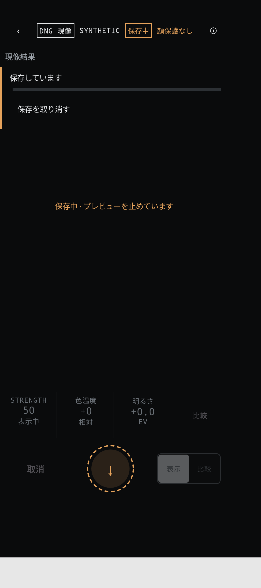|
|取消中|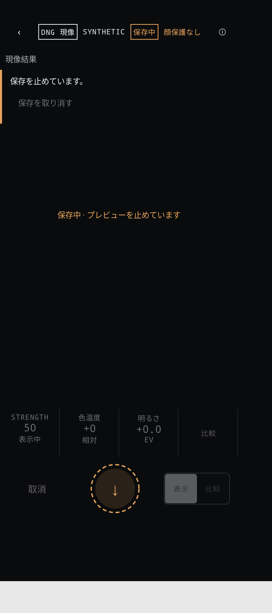||

### 短画面

|工程|変更前|変更後|
|---|---|---|
|保存の準備中|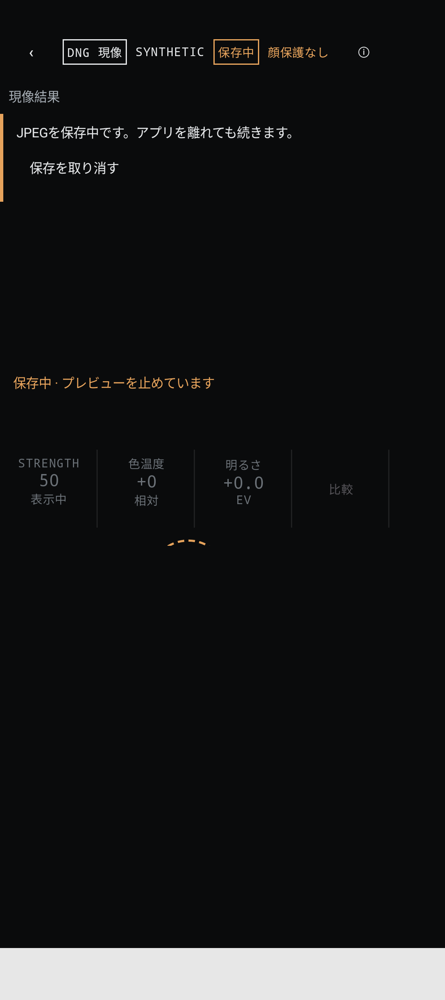|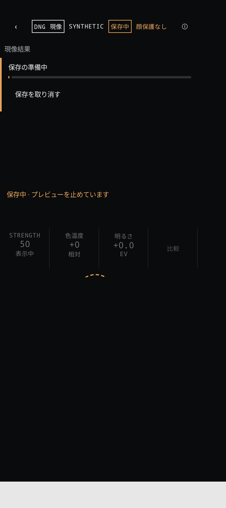|
|画像を現像中||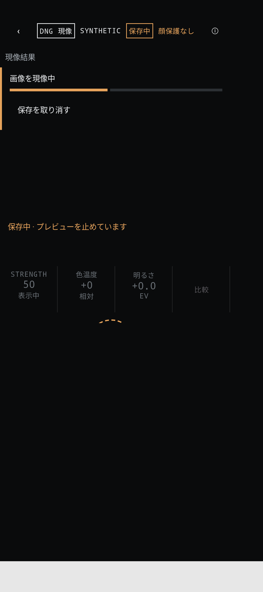|
|JPEGを作成中||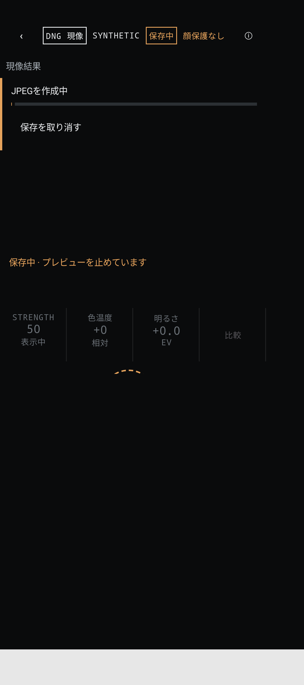|
|保存しています||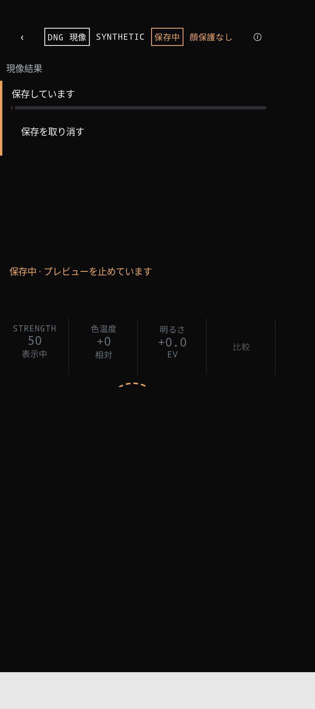|
|取消中|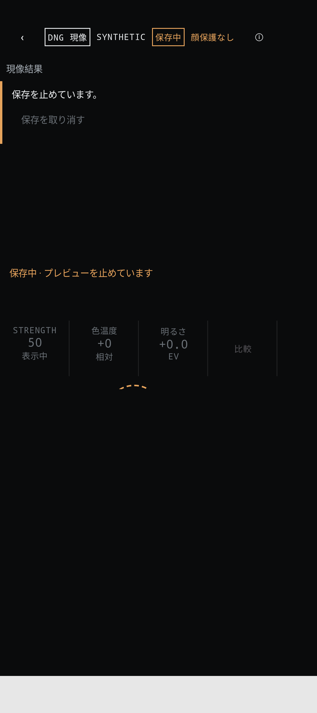|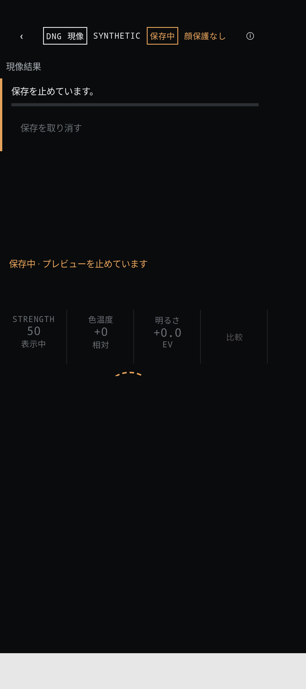|

### 文字2倍

|工程|変更前|変更後|
|---|---|---|
|保存の準備中||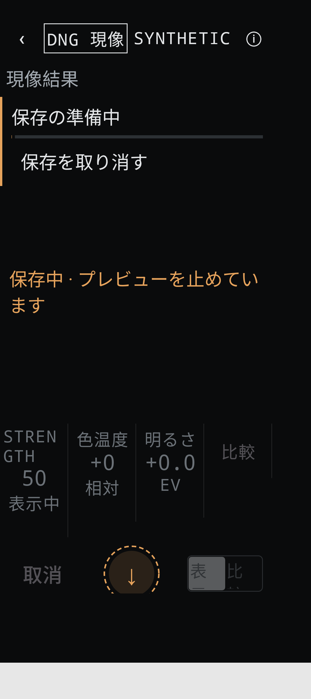|
|画像を現像中||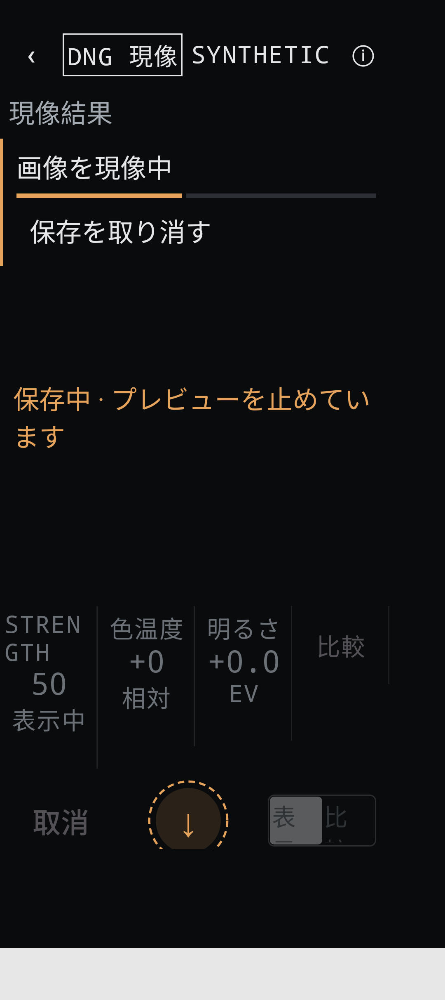|
|JPEGを作成中||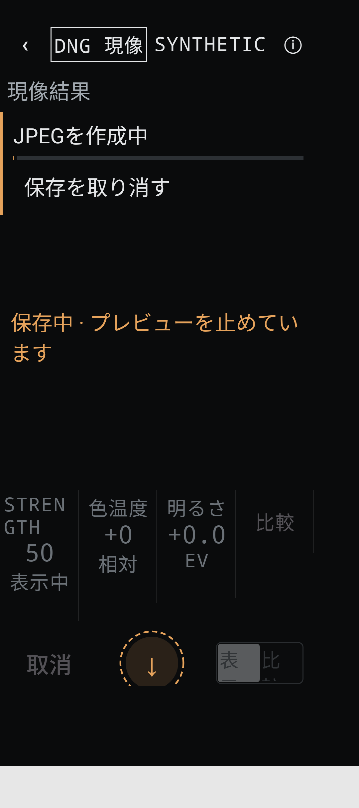|
|保存しています|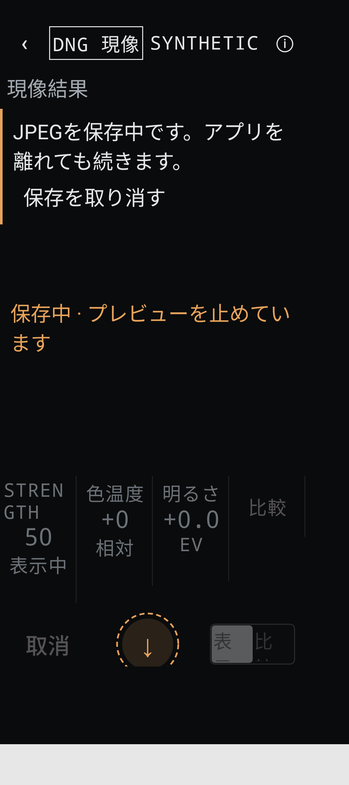|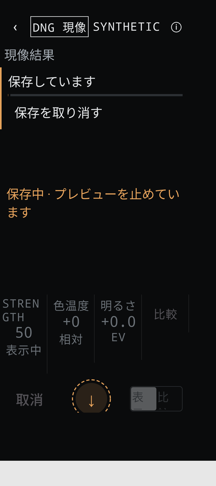|
|取消中|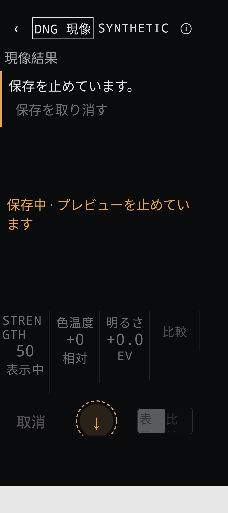|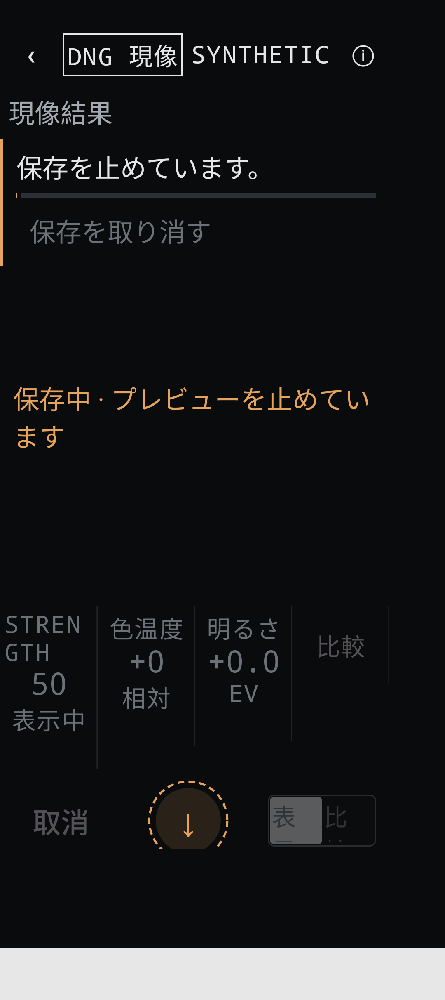|
