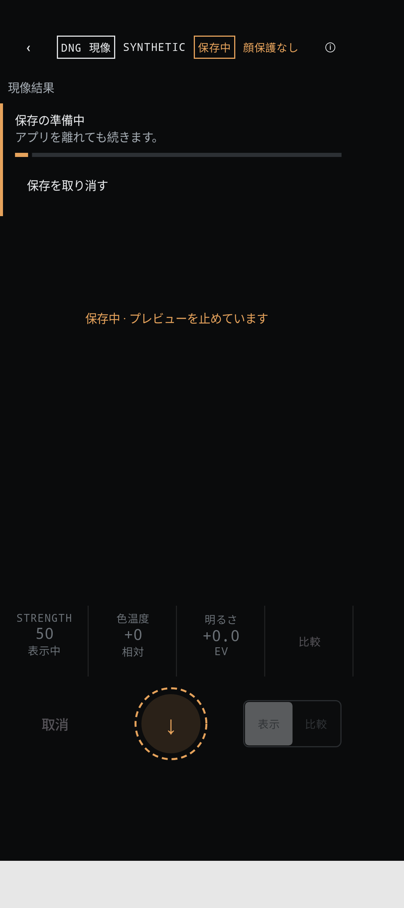
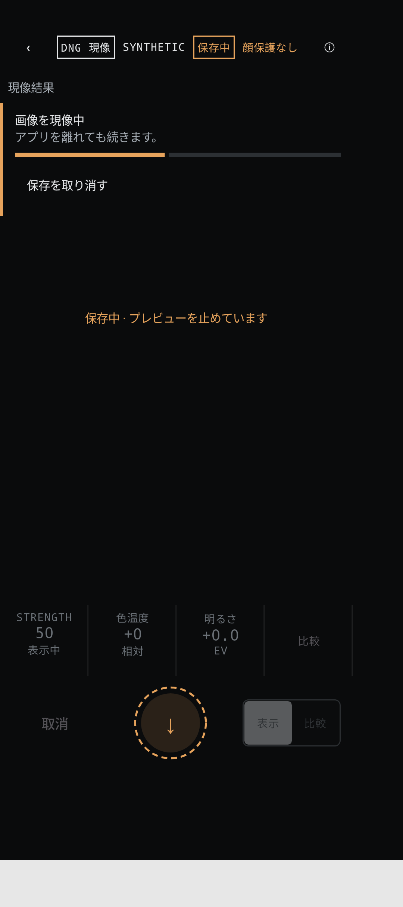
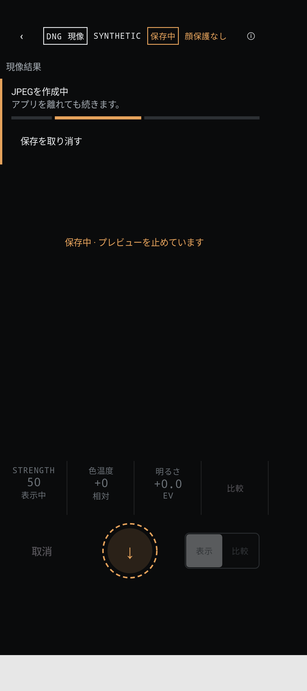
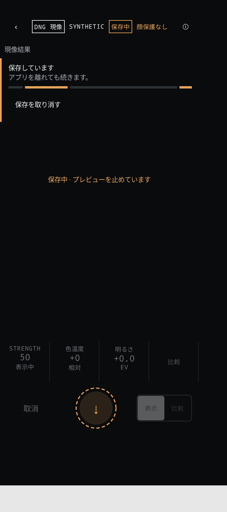
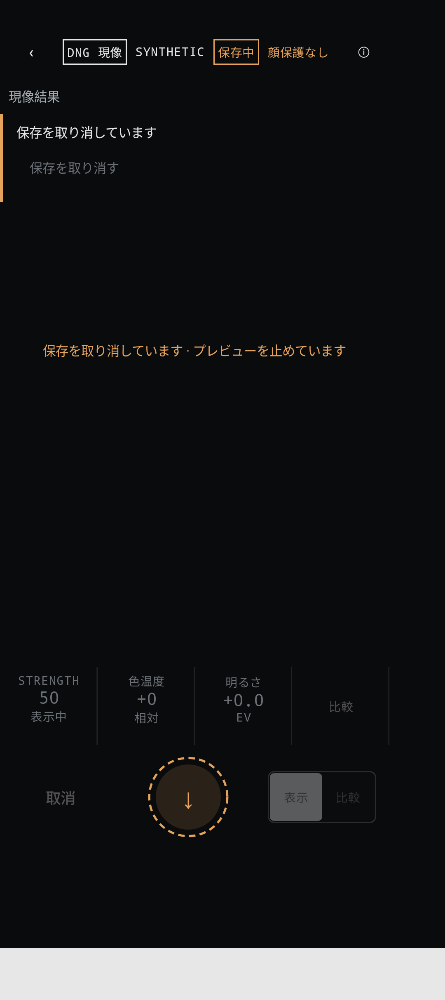

# 保存進捗の最終通常5画面

ソース `a12d268c`（#443・#449を含むmain同期後）。修正後の5枚/動く不定進捗は本人承認済み。その後の本人指定により、取消中バナーも「保存を取り消しています」に統一しました。中央文言は維持しています。

[不定進捗の短録画（MP4）](save-progress-animation.mp4)

合成fixtureのみ。静止画はSoftware View capture、録画は同じ専用AVDの画面。工程ごとに表示を保持しており実保存時間ではありません。準備/JPEG/保存の線は動く不定進捗で、取消中は線なしです。保存取消はバナーの1個、左下の無効な編集取消とは別です。

## 保存の準備中

## 画像を現像中

## JPEGを作成中

## 保存しています

## 保存を取り消しています

短画面/文字2倍の既存問題は [#451](https://github.com/reitojike/cinematic-camera/issues/451) で別に追います。
