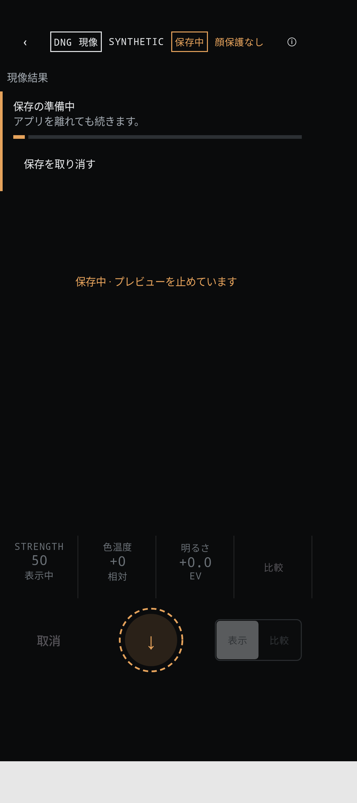
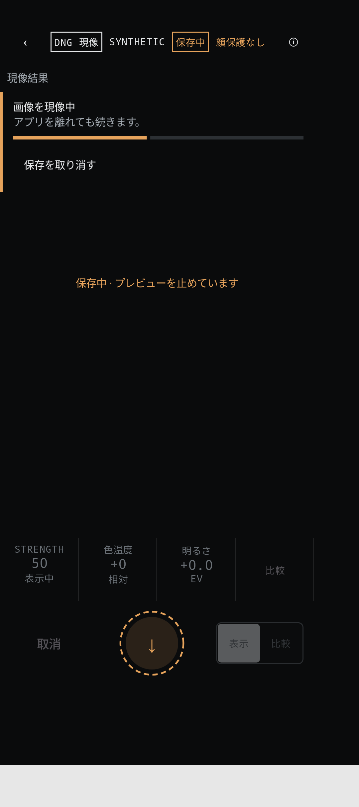
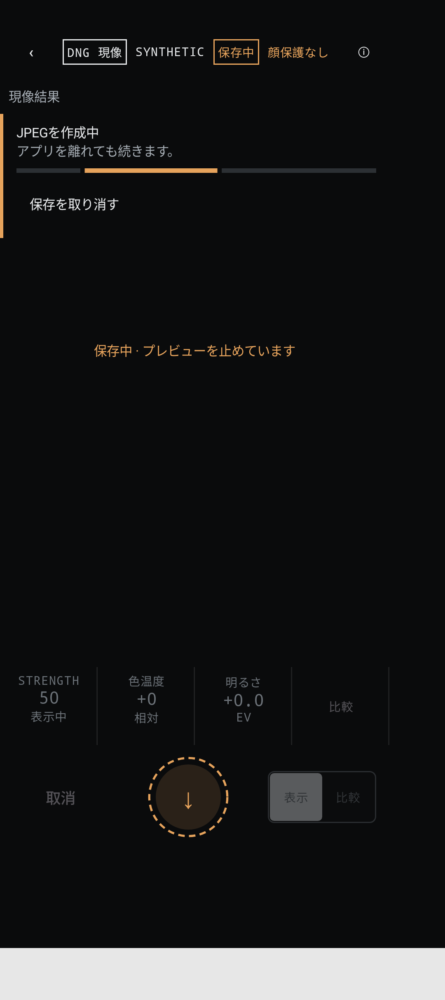
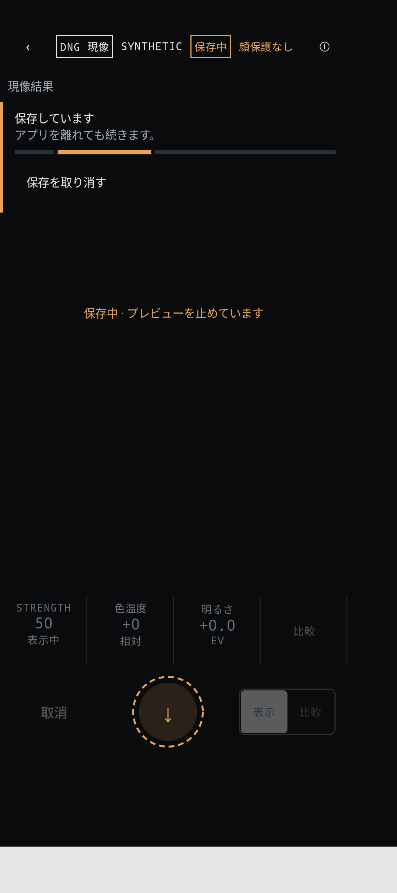
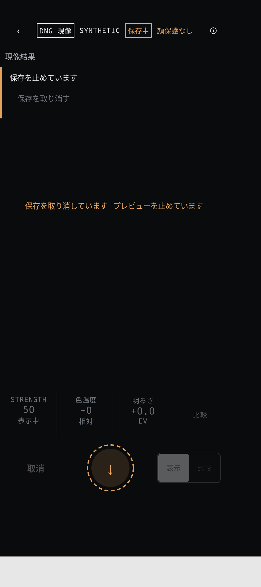

# 保存進捗の修正後（通常画面5枚）

ソース `691e56c3`。本人の見た目確認済み。後続の本人指示で取消中バナーを中央と同じ「保存を取り消しています」に変更した[最新版](../final/README.md)を参照。合成fixtureのみで、実写真・原本・実保存は使っていません。

- 4工程の下に「アプリを離れても続きます。」を復帰。
- 準備・JPEG作成・保存のバーは動く不定進捗。下の短録画で確認できます。完了率や残時間ではありません。
- 取消中はバーなし。「保存を止めています」は句点なし。中央も取消中の文言に変更。
- 保存取消はバナー内の1個。左下の無効な「取消」は編集取消で別操作です。

[不定進捗が動く短録画（MP4）](save-progress-animation.mp4)

録画は合成画面を順に保持した表示確認であり、工程の実時間・保存速度を表しません。通常5枚のPNGはSoftware View capture、録画は同じAVDの画面です。

## 保存の準備中

## 画像を現像中

## JPEGを作成中

## 保存しています

## 取消中

短画面・文字2倍の既存の切れは [#451](https://github.com/reitojike/cinematic-camera/issues/451) に分離し、この変更では修正していません。
