# PR-D 現像画面の配置：確認一覧

実アプリの表示部品を、**合成状態・空の GPU Surface** で採取した一覧です。黒い領域は写真ではありません。画像はソフトウェア View-tree 採取で、実写真・GPU画質・性能の証明ではありません。主な画面は左が変更前、右が変更後です。画像を開くと拡大できます。

変更前：main `2d0a414b`。変更後の製品コード：`b927bd34`（以後は試験のみ変更）。再保存の変更前だけは、前回承認された #435 の同じ合成ダイアログを使用しています。

## 01 通常
キャプションを「現像結果」に短くし、長押しの説明を INFO へ移しました。

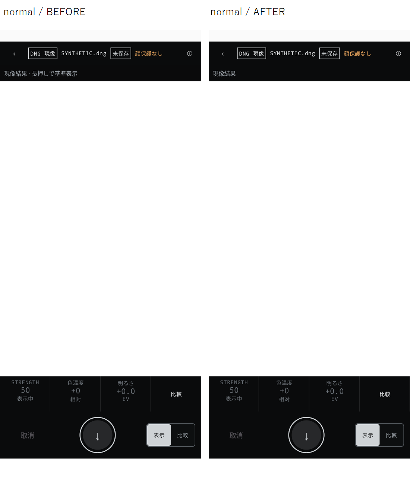

## 02 調整パネル
画像の上に重ねず、画像の下へ分離しました。画像領域はパネルの開閉で伸縮します。

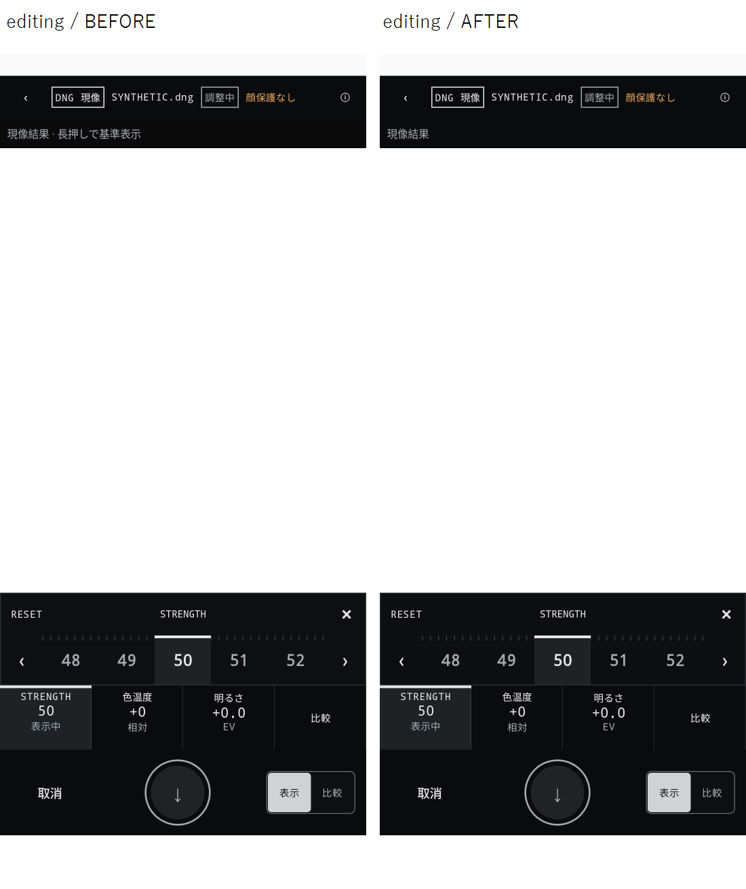

## 03 未反映
要求した表示に追いつくまでは「現像結果 · 更新中」（WARNING）。GPUが表示した値に一致すると通常へ戻ります。保存できる条件は変えていません。

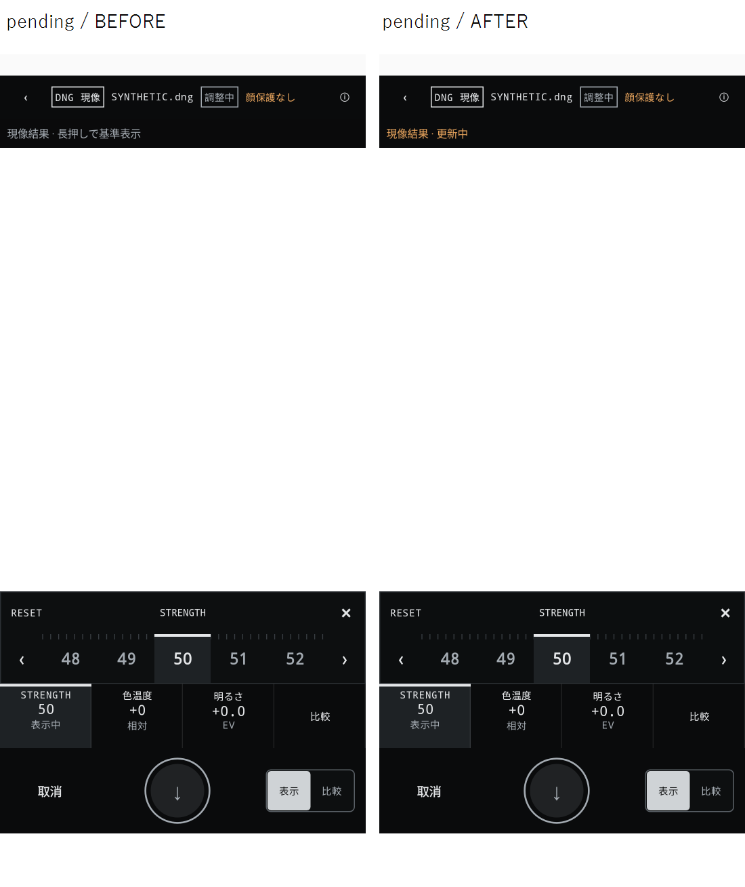

## 04 保存中
キャプションとバナーは縦に並びます。中央の「保存中 · プレビューを止めています」と保存バナーは別の事実として両方残します。

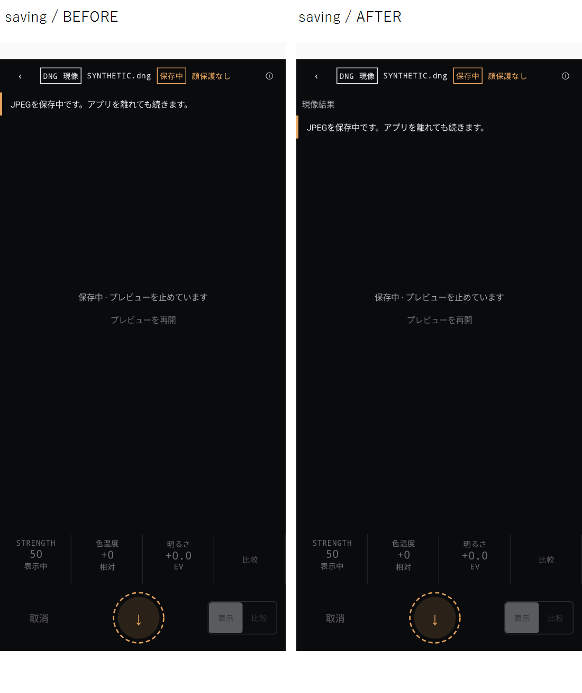

## 05 取消後／06 原本エラー

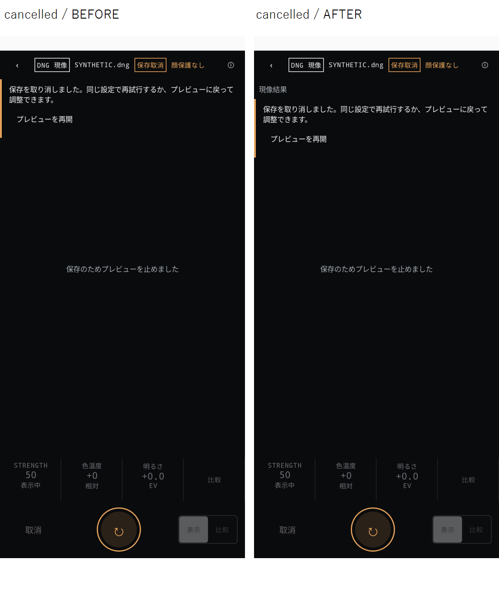

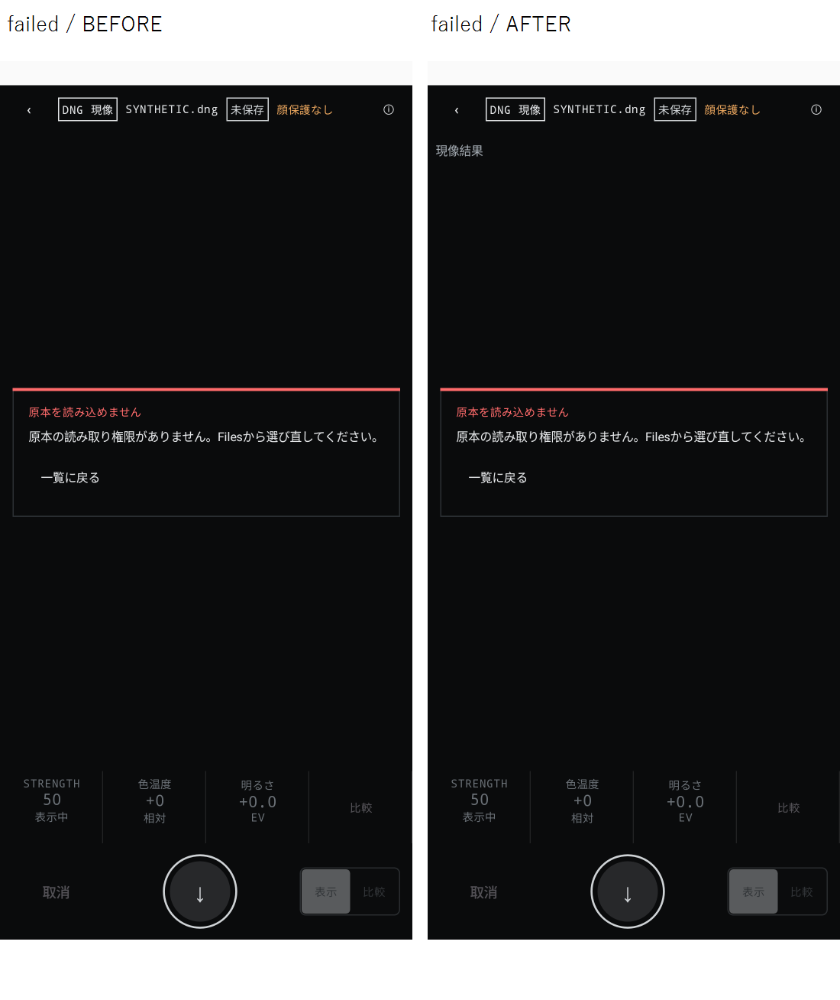

## 07 短い画面・拡大文字
高さ 500dp、文字 1.3倍を画面上部で再現しています。白い下半分は試験枠の外です。画像は 260dp を保ち、問題カード・調整パネル等はその下へ。下の操作はスクロールして到達できます。

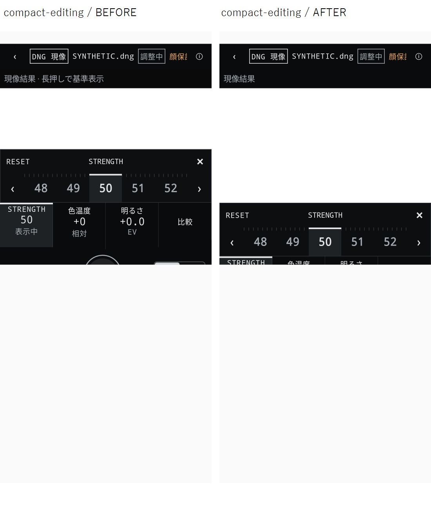

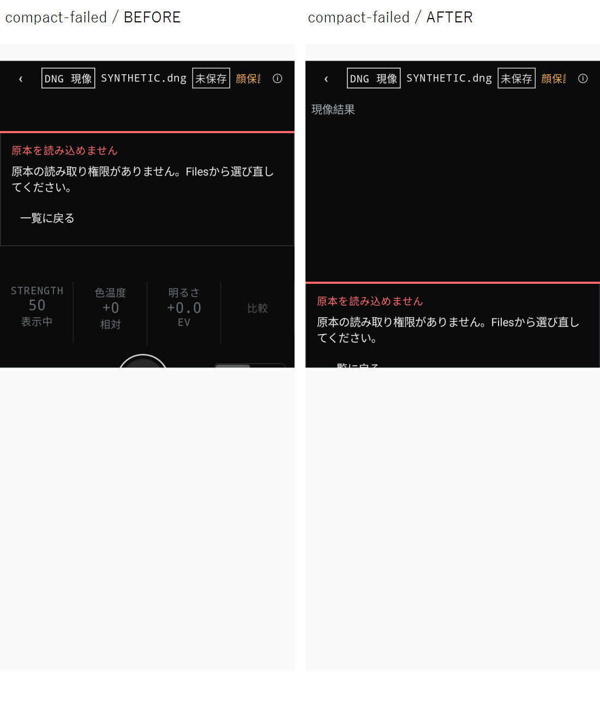

変更後、スクロールして操作へ到達した状態：

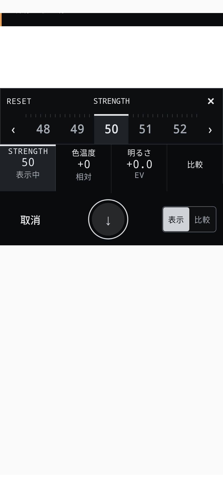

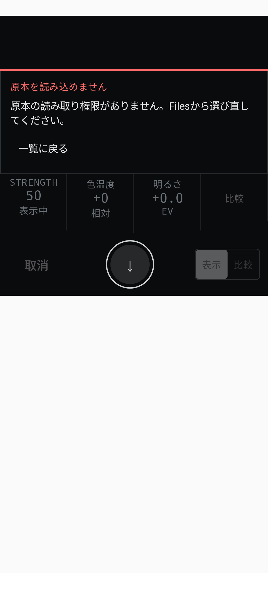

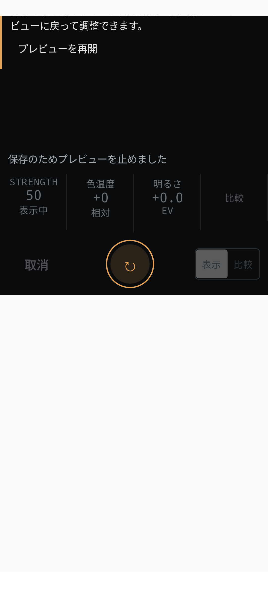

## 08 比較・長押し（変更後）
「基準表示（撮影時WB・調整なし）」と表示します。比較の保持、通常からの長押し／指を離して復帰、比較保持中の長押しで保持が消えないことを操作試験で確認しました。

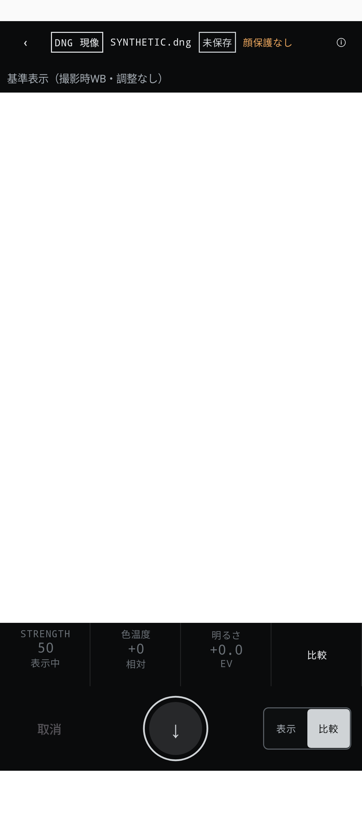

## 09 再保存確認
順番と強調しない扱いは維持し、危険な操作の直前の間隔を追加しました。

変更前：
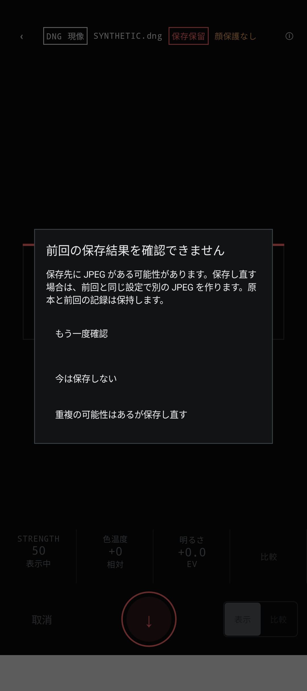

変更後：
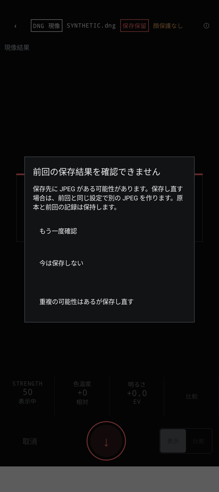

## 文言変更
| 変更前 | 変更後 |
| --- | --- |
| 現像結果 · 長押しで基準表示 | 現像結果 |
| 撮影時WBのRAW基準表示（R7・ルック・手動調整なし、暫定色） | 基準表示（撮影時WB・調整なし） |
| 未反映の明示なし | 上のキャプションに「 · 更新中」を追加 |
| 長押し説明をキャプションに常設 | INFO に「画像を長押ししている間だけ基準表示に切り替わります。」 |

## 検証と残件
- lint／単体 1,385 件（失敗0、skip12）、8状態配置、INFO開閉と再保存ダイアログ、自動操作3試験成功。
- GPU90／帯28成功、承認基準と全画素差0。環境差（Google APIs→AOSP）あり。
- 自動操作の証拠を、実写真や手動回帰と混同しません。手動回帰と本人の見た目承認、最終CI／レビューはマージ前の別条件です。
- CPU互換の旧引数の全廃は、非GPU呼出と保存ownerの境界が残るため、この表示変更に無断で混ぜていません。

## 追加：実製品での手動回帰

[合成DNGをFilesから開き、編集・保存・取消・再試行した記録](manual/README.md)。空Surfaceの固定状態比較とは別の証拠です。発見した停止中captionの不整合と修正も記録しています。
