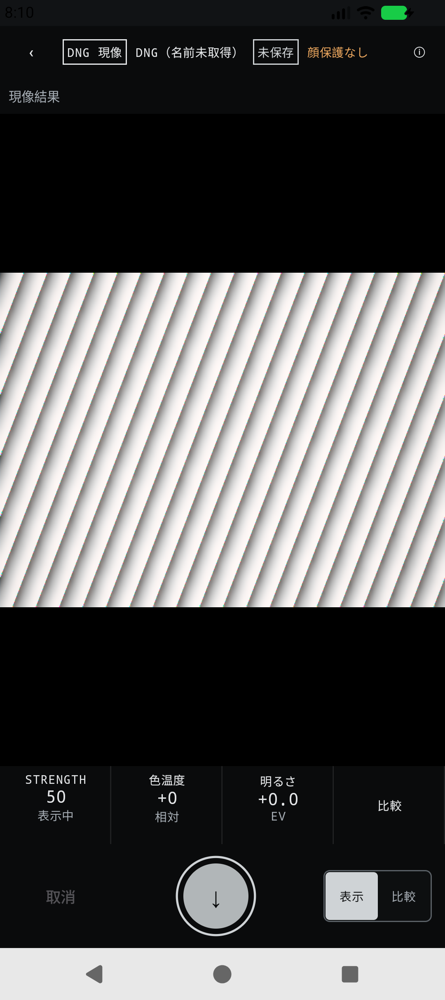
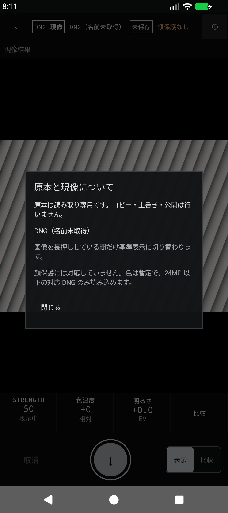
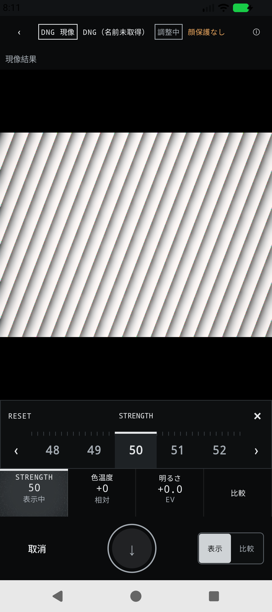
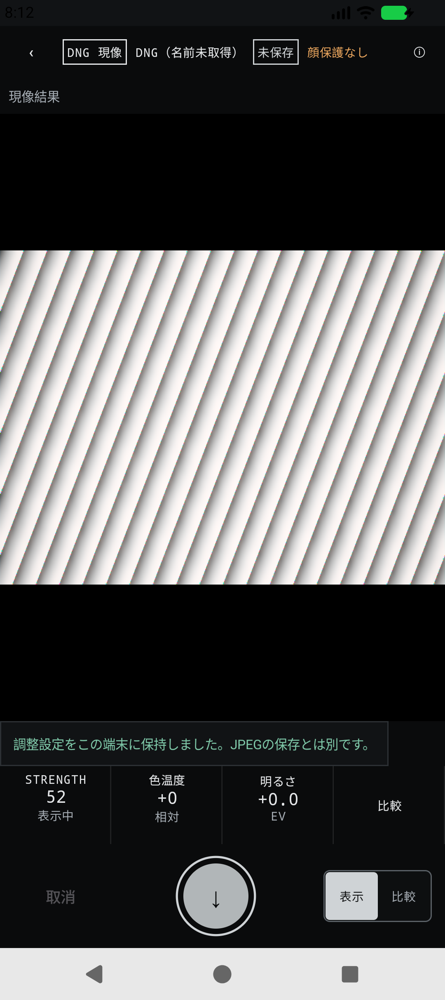
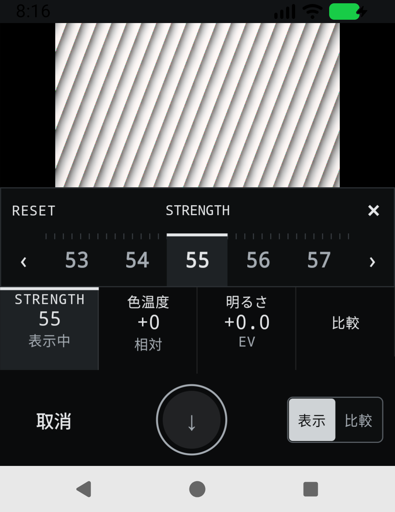
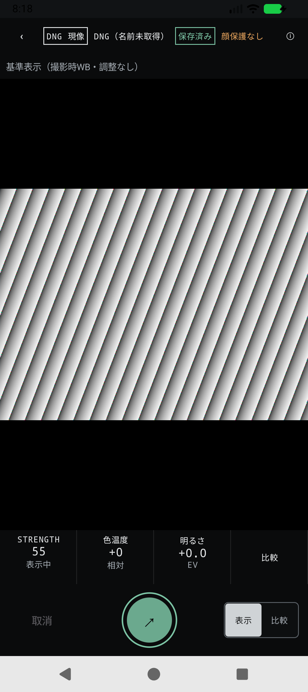
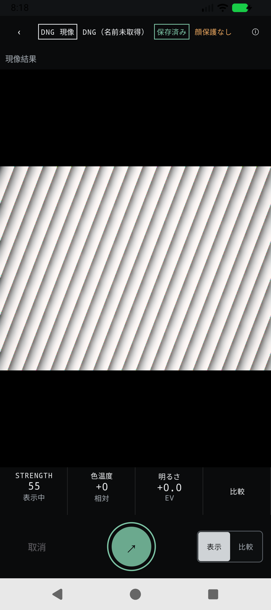
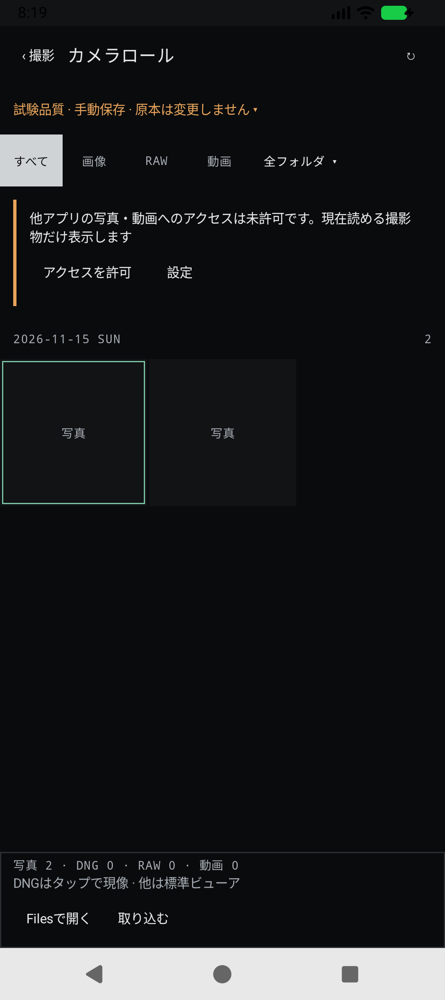

# PR-D Android手動回帰（非個人・合成DNG）

これは空Surfaceの固定状態一覧とは別の、実製品APKを操作した記録です。入力は1024×768の合成Bayer DNG（既存 SyntheticTrialDng と同じTIFFタグ・画素式）であり、ユーザーの写真・Pixelは使用していません。APKの製品コードは53b9f98d時点、AOSP read-only cold bootで実施。

## 実操作の結果
- FilesのDownloads専用rootを選んだ際、既存制約の原本エラーが出ることと［一覧に戻る］の実動作を確認。内部ストレージ→Download経由の選び直しで成功。
- 実LibRaw読込→GPUプレビュー成功。INFOで長押し説明を確認し、閉じて画面へ復帰。
- 比較モード切替・画像の長押し中の基準表示・離して現像結果へ復帰を確認。
- 強さ50→52へ調整、パネルが画像に重ならず下へ配置されること、閉じて設定保持することを確認。
- 保存中の中央表示とバナーが両方残り、JPEG保存完了。さらに強さ55へ変更し、保存を取り消して同じ設定で再試行し完了。
- 1024×768のJPEGを2件生成。213,026 bytes／211,114 bytes、実ファイルをデコードできることを確認。
- 合成原本SHA256は操作前後で不変（796555f835a38a94162383dc9f037023a1fd6400037d7b5f3f0e287ccd64bf3a）。
- 一時的に1080×1400・文字1.3倍へ変更し、実画像・調整パネル・操作行へスクロール到達。元の1080×2424・文字1.0へ戻した。
- 一覧へ戻り「写真2」を確認。終了時boot1／system_server不変／ANR0、担当AVDのみ停止。

## 発見して修正した表示不整合
保存のため意図してプレビューを止めているとき、presented=nullによりcaptionにも「更新中」が出ていました。41e22b51で、実際に動くプレビューsessionがあり、BLOCKED/PAUSEDでない場合だけ更新中にするよう表示条件を修正しました。保存条件やownerは変更していません。修正後の再回帰結果はPR #440の記録を参照してください。

この操作は保存の全障害・公開不明・プロセス死亡の網羅試験や実機の画質保証ではありません。それらは既存安全試験・実機確認と別です。写真への変更を伴わない単なる表示整理として、本人成果物の見た目承認前はマージしません。

## 実画面の抜粋

## 修正後の保存中表示へのリンク

[修正後41e22b51の画面試験画像と、修正前実保存画像の区別](../README.md#10-保存中の修正後41e22b51)。旧実保存画像は不備発見の証拠として残し、修正後の期待表示とは区別しています。
