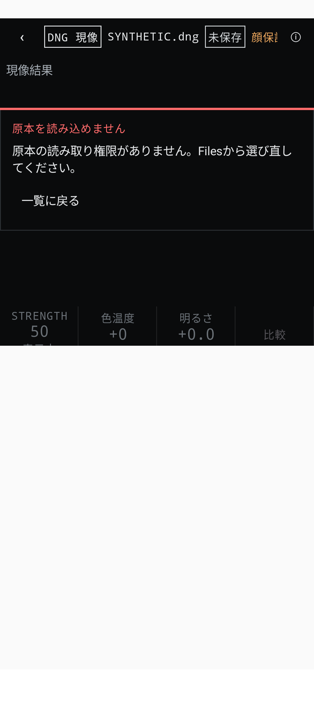
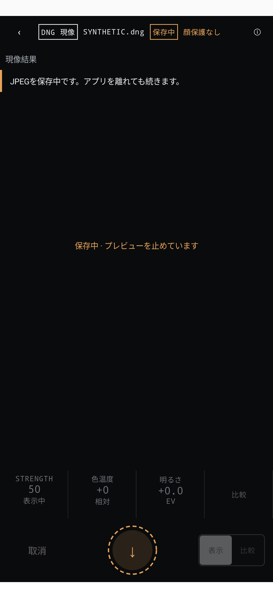

# PR-D 修正後の2画面と確認結果

対象の製品表示変更: 24c2f03d。採取・試験: 1d65bae9。
旧 saving-corrected-41e22b51 ではなく、こちらが追加指示を反映した画像です。

## 1. 原本を読み込めない短画面

問題カードはキャプションの下、260dp の画像領域内に置き、「一覧に戻る」を表示します。500dp・fontScale 1.3 の合成状態試験です。白い下部は試験で短い画面を再現した外側で、製品画面の余白ではありません。

## 2. 保存中

中央表示を WARNING（Amber）とし、保存中の「プレビューを再開」は表示しません。保存後の停止状態には従来どおり残します。製品の表示部品に合成状態と空の GPU Surface を与えた画像であり、実写真の保存画面ではありません。

## 4点の確認結果

1. **3パラメーター切替: 確認済み。** STRENGTH・色温度・明るさでパネルの高さと画像領域の座標・寸法が一致。自動の実操作試験と、合成 DNG を開いた製品画面で確認。
2. **表示・比較・長押し: 確認済み。** 製品の操作導線を用いる試験で実 SurfaceView と画像領域の座標・寸法が一致。
3. **開閉時の再処理・ちらつき: 一部未達。** 同じ入力・sessionを使い、再decodeとFULL_RECOMPUTEを起こさないことはコードとログで確認。ただし実製品の3回開閉を録画した全116フレームに、画像が黒くなるフレームを2件（次の記録フレームまで約12ms／29ms）確認。「ちらつきなし」とは判断できません。
4. **閉じた後の復元: 確認済み。** 実際の×操作で設定保持が完了した直後、通知が出ていても元の座標・寸法に戻ります。

**未達を残してマージしません。** EGLウィンドウ再利用案は画像の位置ずれがあり不採用。Callback2のみを追加する同期案も全124記録フレーム中1件の黒フレーム（約27ms）が残り不採用です。両仮説は製品差分から取り除きました。表示同期の対策を別に検討しています。静止画像を余分に保持する変更や、保存の動作・メモリ方針の変更は行っていません。

録画の全フレームとはエンコードされた全サンプルの抽出を指し、録画器が落とした表示フレームまで保証するものではありません。実機 Pixel の確認ではありません。
