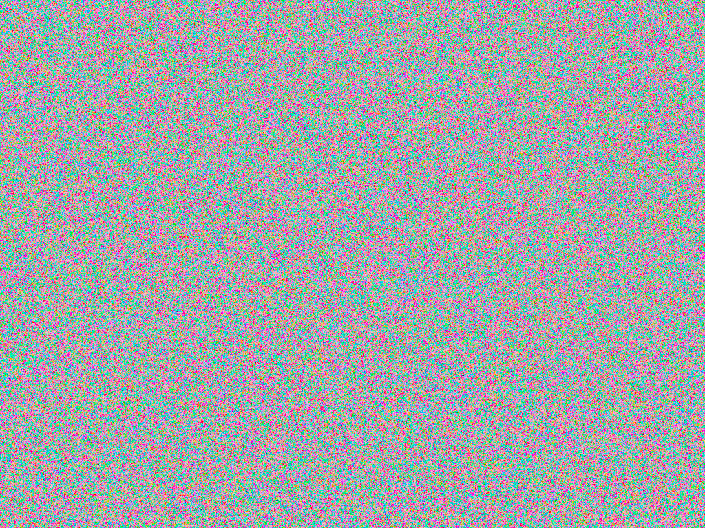
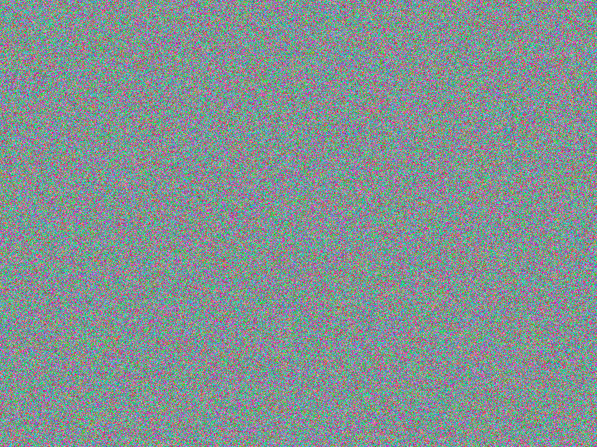
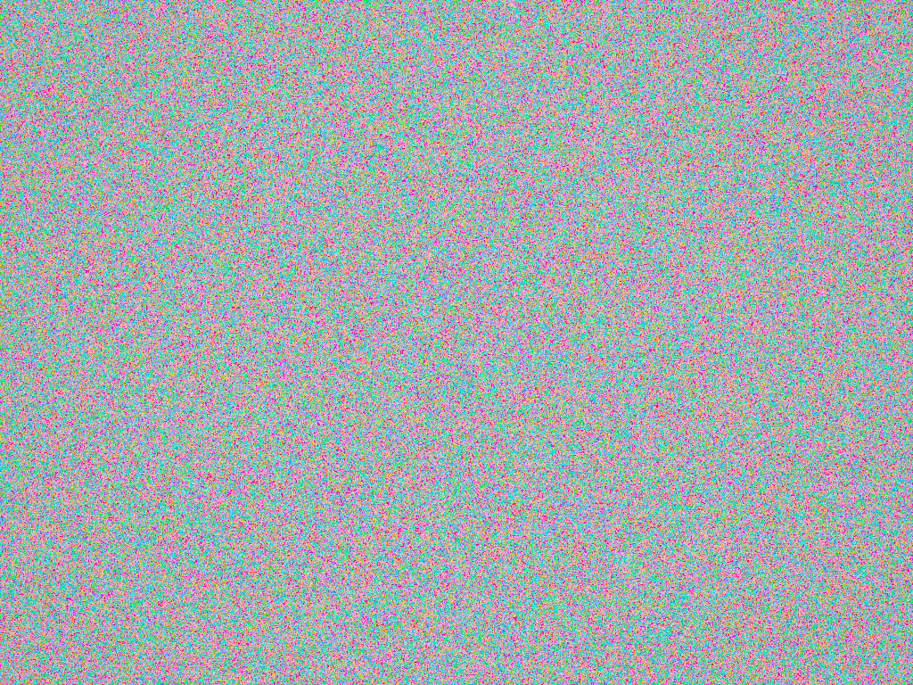
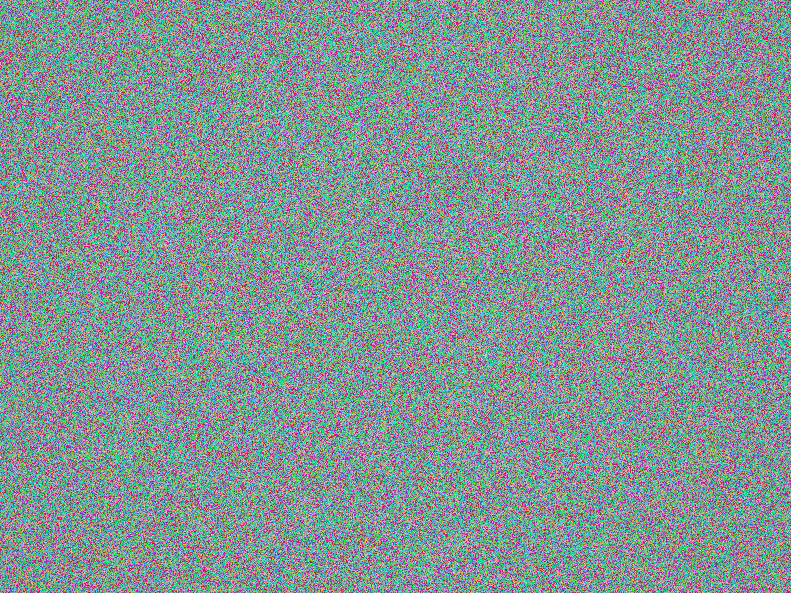
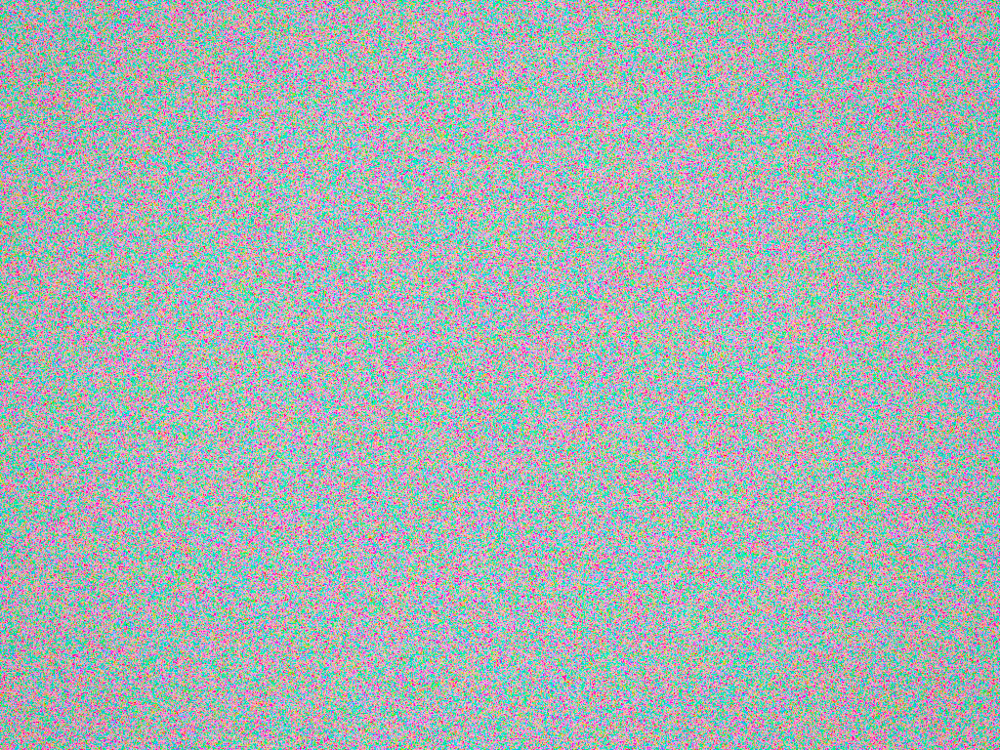
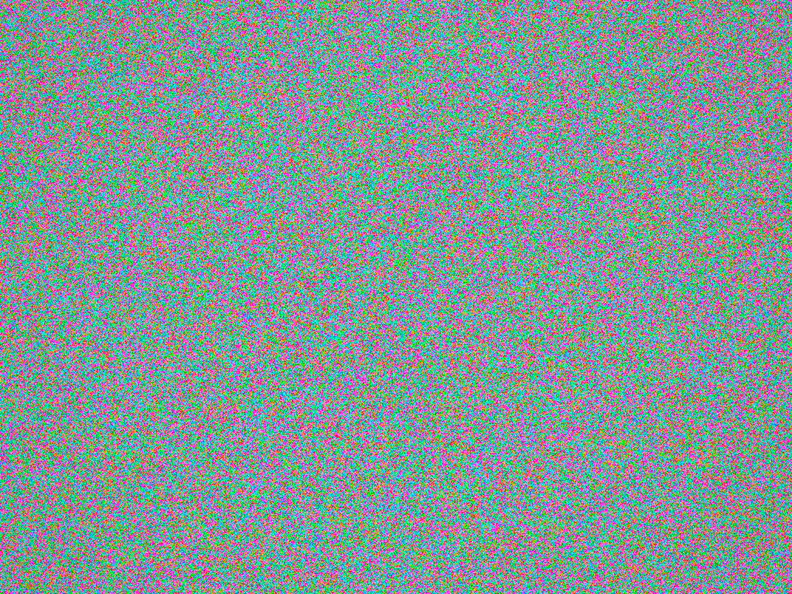
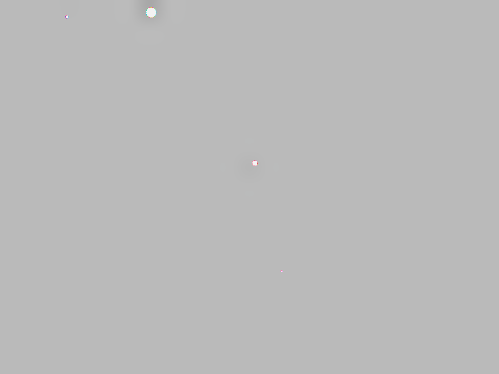
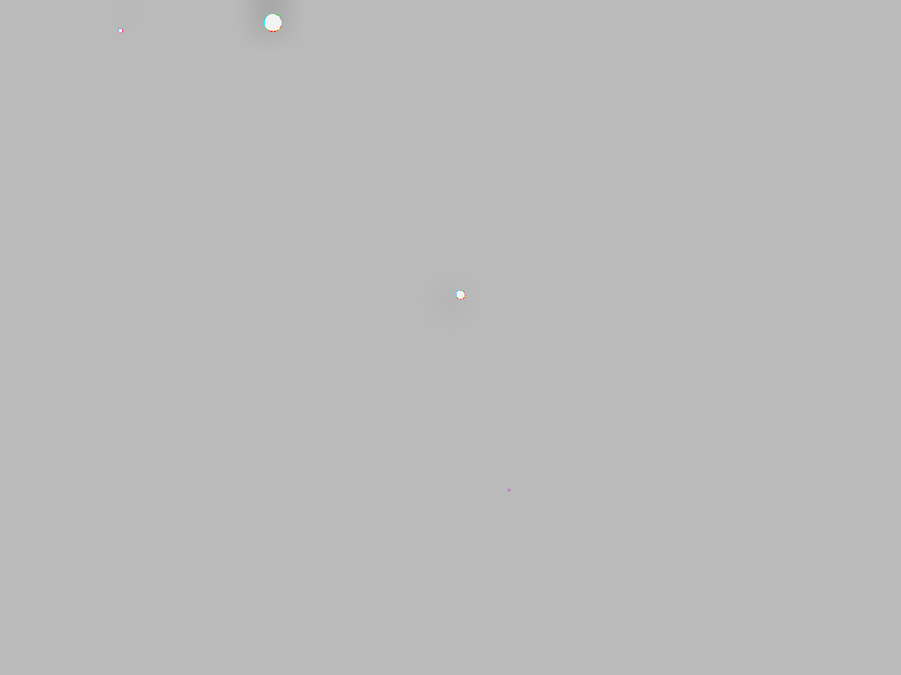
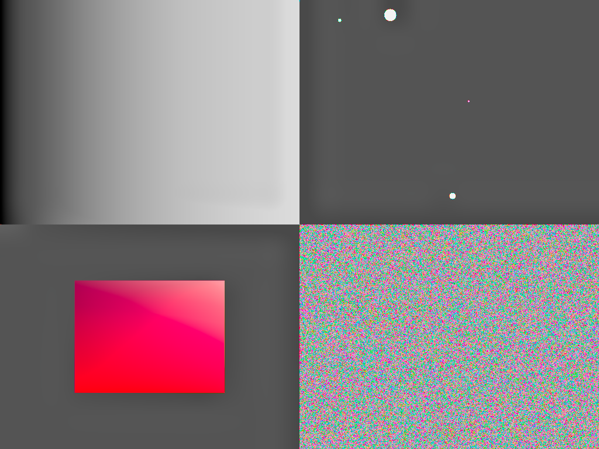
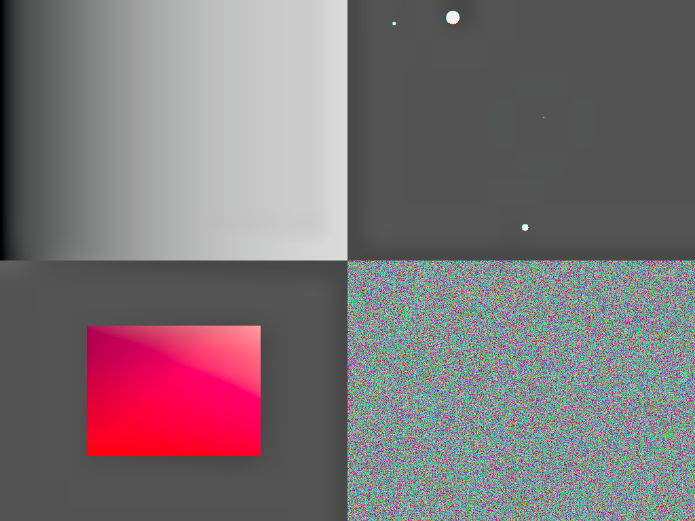

# FULL AHD / half 入力の GPU 後比較（合成・未採用）

比較コード: `bdcddade`。90 条件完走。写真・実機データは含まない。

RAW は比較寸法の 2 倍（最大約 3.15MP）の合成 Bayer。12/24MP 実写の画質・速度の結論ではない。
既存 RGB golden のケース ID/編集値を共有する追加実験で、元 fixture の色や near-white 占有率そのものの再現ではない。
保存は原寸 AHD のまま、half 製品採用は未決定。数値は 8bit RGB 出力間の差。
PSNR が空欄の場合は完全一致。全条件は [metrics.csv](metrics.csv)。

MAE の大きい 3 条件、最大差の最大条件、最悪パターンと別種で最も差の大きい条件を掲載する（重複は省く）。

## c033: NOISE

RAW 2048×1536 → 比較 1024×768。
MAE 55.0302 / 最大 255 / p99 245。

| FULL AHD | half |
|---|---|
|  |  |

## c034: NOISE

RAW 2048×1536 → 比較 1024×768。
MAE 54.3812 / 最大 255 / p99 238。

| FULL AHD | half |
|---|---|
|  |  |

## c035: NOISE

RAW 2048×1536 → 比較 1024×768。
MAE 53.8680 / 最大 255 / p99 234。

| FULL AHD | half |
|---|---|
|  |  |

## c009: HDR_LIGHTS

RAW 2048×1536 → 比較 1024×768。
MAE 0.0192 / 最大 255 / p99 0。

| FULL AHD | half |
|---|---|
|  |  |

## c037: MIXED

RAW 2048×1536 → 比較 1024×768。
MAE 14.5010 / 最大 255 / p99 186。

| FULL AHD | half |
|---|---|
|  |  |
