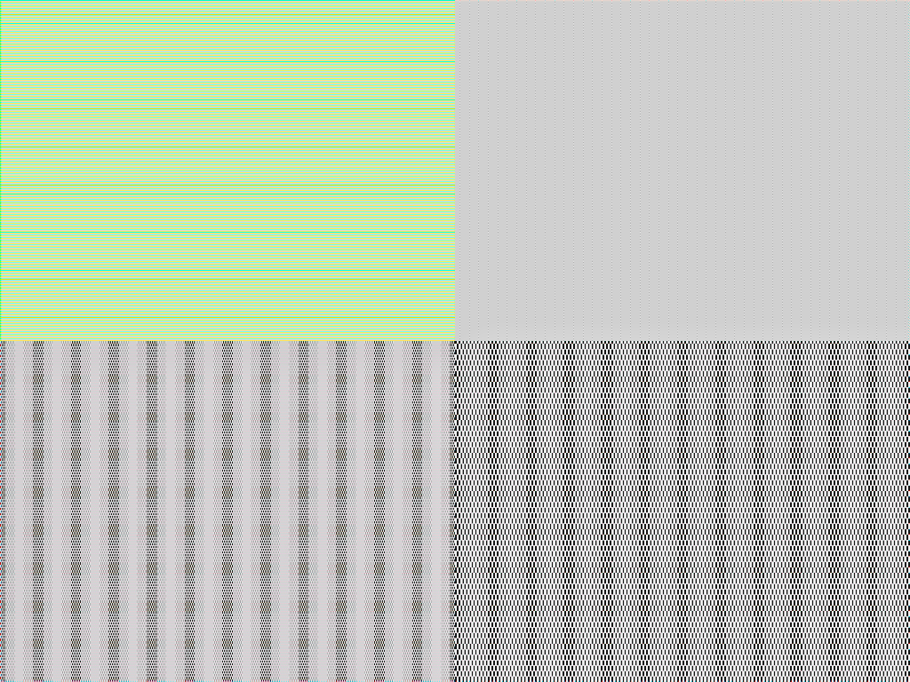
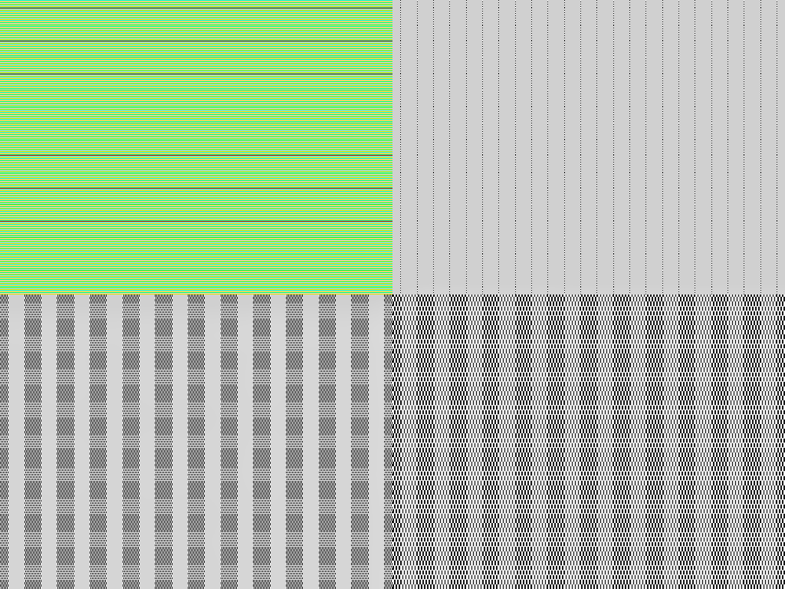
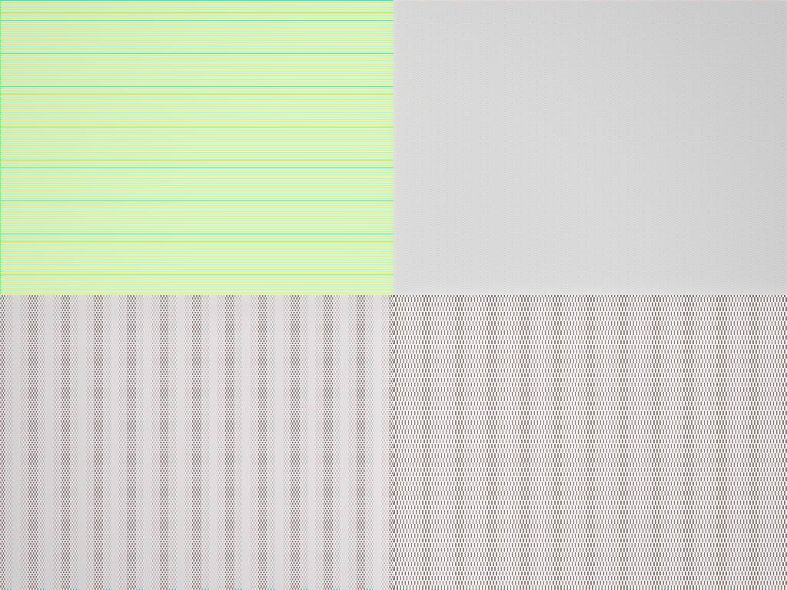
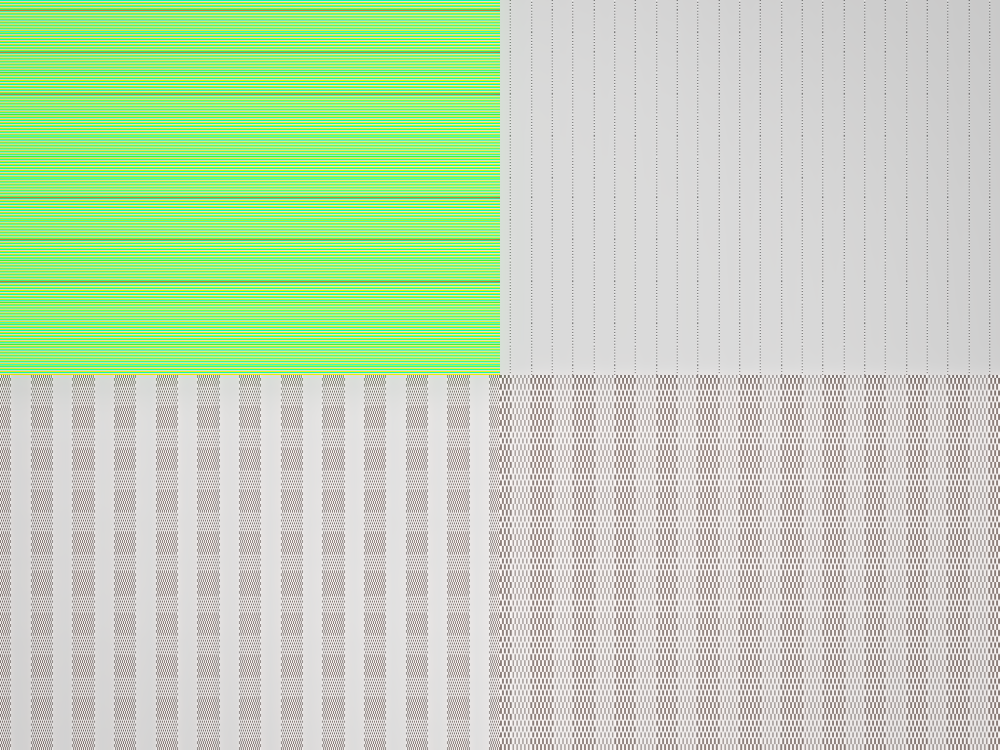
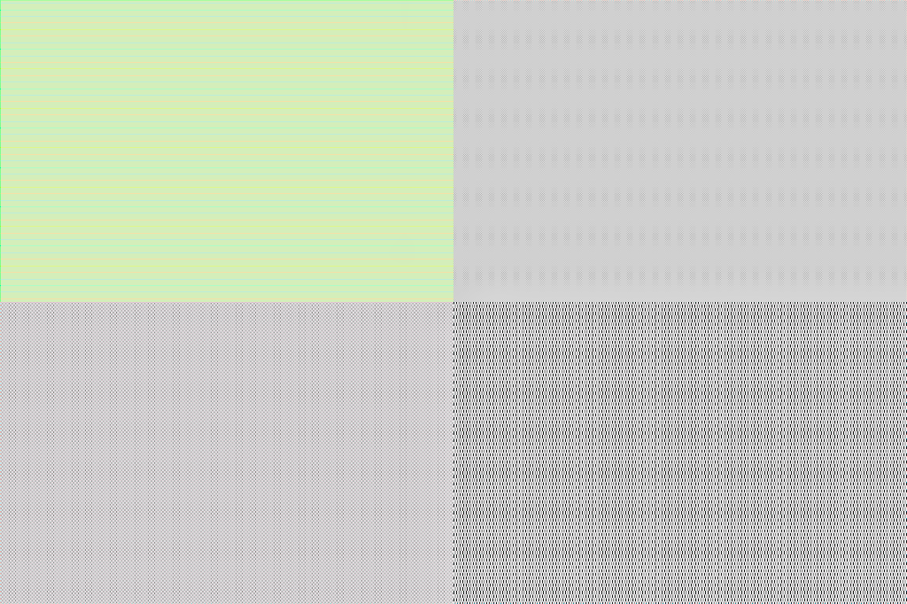
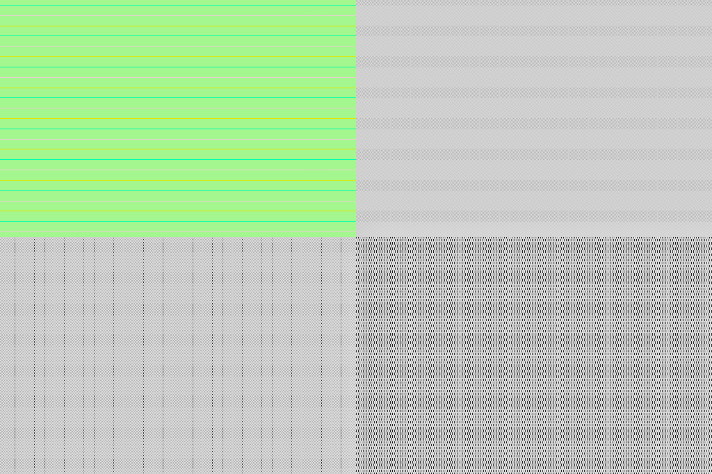
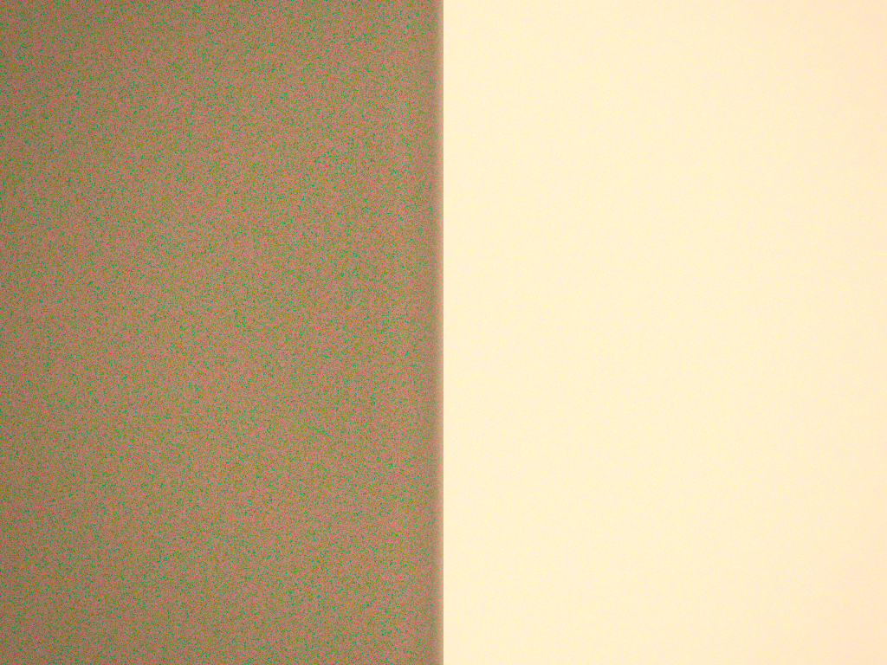
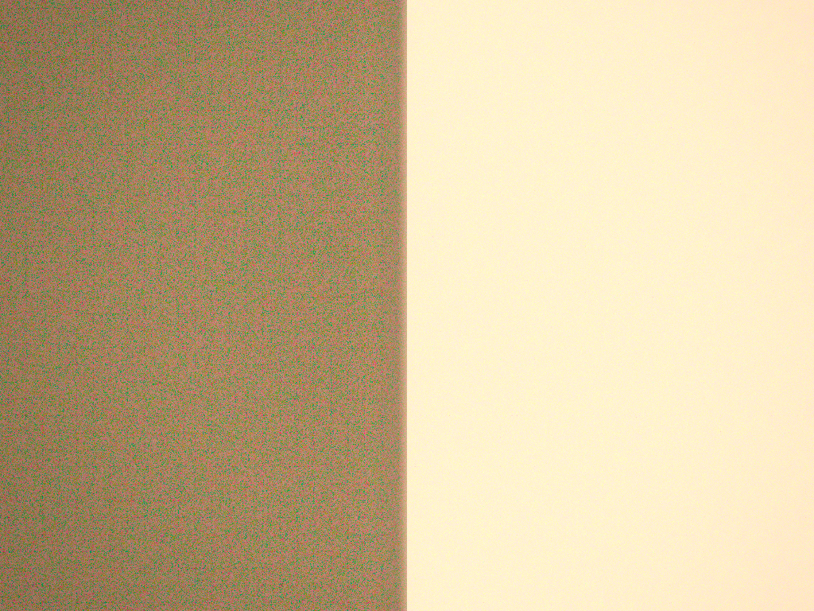

# FULL AHD / half 入力の GPU 後比較（合成・未採用）

比較コード: `d82d9960`。36 条件完走。写真・実機データは含まない。

RAW は直接生成した 4000×3000 / 6000×4000 の合成 Bayer。実写画質・Pixel 速度の結論ではない。
36 条件の補足であり、既存 90 条件の代替ではない。identity ColorMatrix / neutral WB の camera-channel 刺激で、実写色・肌色・センサーノイズのモデルではない。
保存は原寸 AHD のまま、half 製品採用は未決定。数値は 8bit RGB 出力間の差。
PSNR が空欄の場合は完全一致。全条件は [metrics.csv](metrics.csv)。

MAE の大きい 3 条件、最大差の最大条件、最悪パターンと別種で最も差の大きい条件を掲載する（重複は省く）。

## l007: MICRO_DETAIL

RAW 4000×3000 → 比較 1024×768。
MAE 25.3470 / 最大 255 / p99 208。

| FULL AHD | half |
|---|---|
|  |  |

## l008: MICRO_DETAIL

RAW 4000×3000 → 比較 1024×768。
MAE 21.2185 / 最大 242 / p99 216。

| FULL AHD | half |
|---|---|
|  |  |

## l025: MICRO_DETAIL

RAW 6000×4000 → 比較 1024×682。
MAE 16.7924 / 最大 214 / p99 111。

| FULL AHD | half |
|---|---|
|  |  |

## l015: NOISE

RAW 4000×3000 → 比較 1024×768。
MAE 10.4683 / 最大 223 / p99 88。

| FULL AHD | half |
|---|---|
|  |  |
